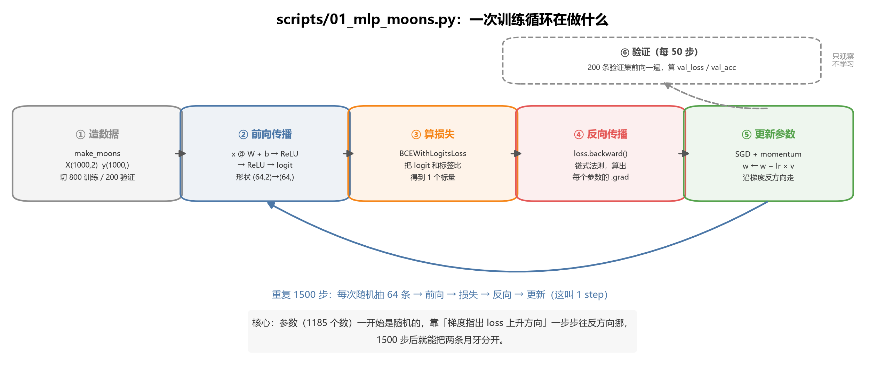
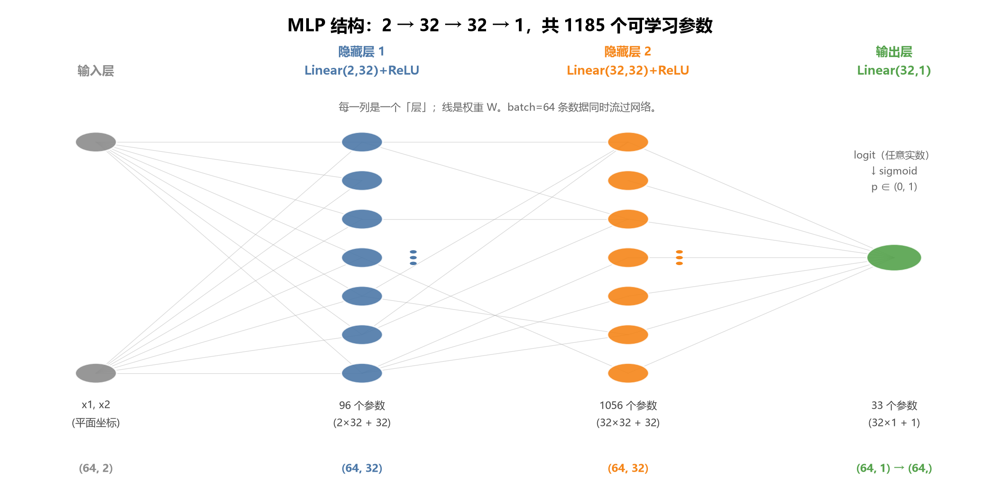
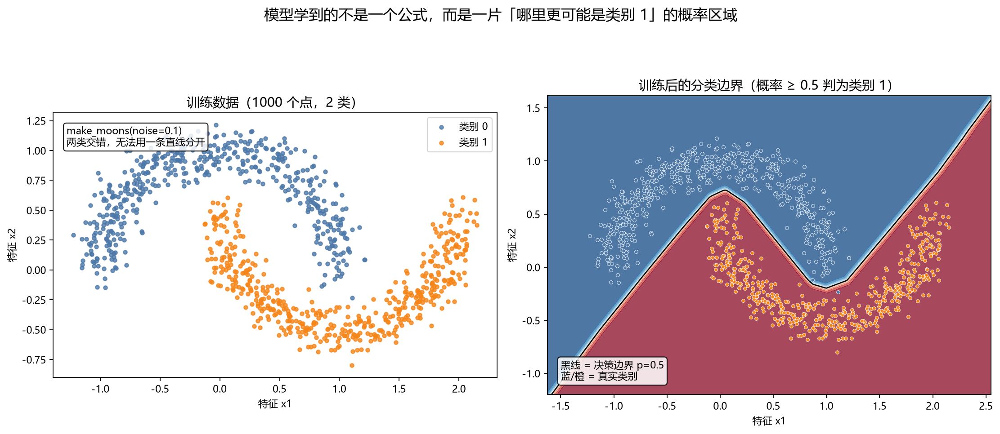

# 实验 01 图解：`scripts/01_mlp_moons.py` 到底在做什么

一句话：**造一批二维点 → 用一个 2→32→32→1 的小网络猜每个点属于哪一类 → 用「猜错的程度」反推每个参数该怎么改 → 重复 1500 次。**



整份脚本只有 130 行左右，可以拆成 6 块：

| 代码块 | 行号（约） | 做的事 |
| --- | --- | --- |
| ① 解析参数 | 39–50 | 步数、学习率、batch 大小、设备 |
| ② 造数据 | 58–64 | `make_moons` 生成 1000 个点，切 800/200 |
| ③ 建模型 | 66–69 | 三层手写 MLP，参数搬到 GPU |
| ④ 定优化器/损失 | 71–72 | SGD + momentum、BCEWithLogitsLoss |
| ⑤ 训练循环 | 74–94 | 前向 → 损失 → 反向 → 更新，重复 1500 次 |
| ⑥ 评估与保存 | 96–120 | 算最终准确率，画曲线，存权重和数据 |

下面按执行顺序讲。

---

## ① 解析参数（第 39–50 行）

```python
p.add_argument("--steps", type=int, default=1500)
p.add_argument("--batch-size", type=int, default=64)
p.add_argument("--lr", type=float, default=0.05)
p.add_argument("--device", default="auto")
```

这些叫**超参数**：不是模型学出来的，而是你设定的。`--device auto` 表示有 CUDA 就用 GPU。

```python
set_seed(args.seed)
device = pick_device(args.device)
```

固定随机种子（Python / NumPy / PyTorch 三套），保证同样的参数每次跑出同样的结果。

---

## ② 造数据（第 58–64 行）

```python
X, y = make_moons(n_samples=1000, noise=0.1, seed=0)
X_tr, y_tr, X_val, y_val = train_val_split(X, y, val_ratio=0.2, seed=0)
```

- `X` 形状 `(1000, 2)`：1000 个点，每个点有 x1、x2 两个坐标。
- `y` 形状 `(1000,)`：每个点的类别，0 或 1。
- `noise=0.1`：给坐标加一点高斯噪声，避免数据太「干净」。
- 切分：800 条训练、200 条验证。验证集不参与更新，只用来检查「没见过的数据」上的表现。

```python
Xtr = torch.from_numpy(X_tr).to(device)
```

NumPy 数组 → PyTorch 张量，并搬到 GPU（如果可用）。模型和数据必须在同一设备上才能做矩阵乘法。

---

## ③ 建模型（第 66–69 行）

```python
model = MLP(2, args.hidden, seed=args.seed)
for layer in (model.fc1, model.fc2, model.fc3):
    layer.weight.data = layer.weight.data.to(device)
    layer.bias.data = layer.bias.data.to(device)
```

`MLP` 在 `src/rldl/manual_nn.py` 里手写实现，没有用 `torch.nn`：



- `fc1: Linear(2, 32)`：把 2 维坐标变成 32 维特征，96 个参数（`2×32 + 32`）。
- `fc2: Linear(32, 32)`：再变换一次，1056 个参数。
- `fc3: Linear(32, 1)`：输出 1 个数（logit），33 个参数。
- 合计 **1185 个可学习参数**。训练就是调整这 1185 个数。

每个 Linear 内部只有两个张量：`weight (in, out)`、`bias (out,)`，前向就是 `x @ W + b`。两个 Linear 之间夹一个 ReLU，否则多层线性叠加等价于一层，学不会弯曲的边界。

---

## ④ 优化器与损失（第 71–72 行）

```python
optimizer = torch.optim.SGD(model.parameters(), lr=args.lr, momentum=0.9)
loss_fn = torch.nn.BCEWithLogitsLoss()
```

- **优化器**：知道「参数列表 + 梯度」，按 `w ← w − lr × v` 更新，`v` 是带动量的累积梯度。
- **损失函数**：输入 logits（未归一化的分数）和 0/1 标签，输出一个标量，衡量这批数据错得多离谱。内部等价于 `sigmoid + 二元交叉熵`，但数值更稳定。

---

## ⑤ 训练循环（第 74–94 行，核心）

```python
for step in progress:
    idx = torch.randint(0, n, (args.batch_size,), device=device)  # 1. 抽 64 条
    logits = model.forward(Xtr[idx])                              # 2. 前向
    loss = loss_fn(logits, ytr[idx])                              # 3. 算损失
    optimizer.zero_grad(set_to_none=True)                         # 4. 清旧梯度
    loss.backward()                                               # 5. 反向传播
    optimizer.step()                                              # 6. 更新参数
```

逐步解释：

1. **抽 batch**：从 800 条里随机抽 64 条。用一小批而不是全部，速度快、显存小，梯度带点噪声反而有助于跳出局部极小。
2. **前向**：`(64,2) → (64,32) → (64,32) → (64,1) → (64,)`，得到 64 个 logit。
3. **算损失**：把这 64 个 logit 和对应标签比，得到一个标量。
4. **清梯度**：PyTorch 的 `.grad` 是累加的，不清就会把上一步的梯度加进来。
5. **反向**：autograd 从 loss 沿计算图倒着走，用链式法则算出 loss 对每个参数的偏导，存进 `.grad`。
6. **更新**：优化器读取 `.grad`，把 1185 个参数各挪一小步。

为什么是「重复 1500 步」而不是「跑 1500 个 epoch」：800 条 ÷ 64 ≈ 13 步才算过完一遍训练集，1500 步约等于 115 遍。学习阶段用 step 计数更直观。

---

## ⑥ 验证与保存（第 88–120 行）

```python
if step % 50 == 0 or step == 1:
    with torch.no_grad():
        val_logits = model.forward(Xva)
        val_acc = accuracy(val_logits, yva)
```

每 50 步在 200 条验证集上前向一次：

- `torch.no_grad()`：不需要梯度，省显存、更快。
- 验证只观察，不调用 `backward()` / `step()`，所以不会影响模型。

训练结束后：

```python
torch.save(model.state_dict(), args.out / "model.pth")
```

保存的是参数字典，不含代码结构；加载时要先建同样的 `MLP` 再灌参数（`scripts/02_visual_explain.py` 就是这么做的）。

---

## 结果长什么样

左边是原始数据，右边是训练后的分类边界：



网络没有学到一个显式的公式，而是学到了一片**概率区域**：颜色越红表示「越可能是类别 1」。黑线是 `p = 0.5` 的分界，它弯着绕开了两条月牙，这就是加 ReLU 的意义。

对应 `outputs/01_mlp_moons/curve.png` 里的两条曲线：

- **val loss** 快速下降后保持接近 0；
- **val acc** 约 200 步到达 0.98 以上，最终 0.995。

如果 val loss 先降后升、train loss 继续降，说明开始**过拟合**——模型在背训练集，而不是学规律。

---

## 自己动手改什么

```bash
uv run python scripts/01_mlp_moons.py --hidden 2      # 网络太小 → 欠拟合
uv run python scripts/01_mlp_moons.py --lr 5          # 步子太大 → loss 震荡/NaN
uv run python scripts/01_mlp_moons.py --noise 0.4     # 数据更难 → 准确率下降
uv run python scripts/01_mlp_moons.py --steps 100     # 训练不足 → 两条曲线都难看
```

改完再跑一次 `uv run python scripts/02_visual_explain.py`，重新生成这三张图（它读取 `outputs/01_mlp_moons/` 里的最新产物）。
