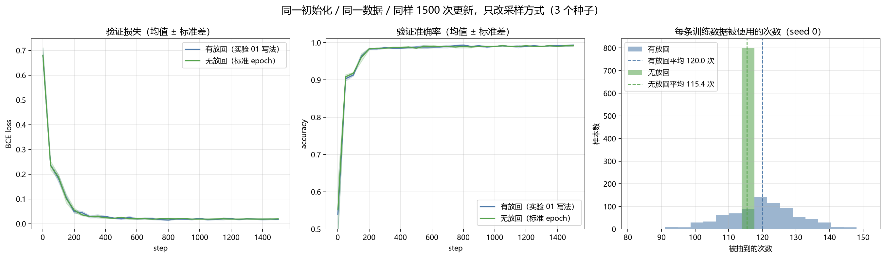

# 实验 03：有放回 vs 无放回采样

脚本：`scripts/03_sampling_ab.py`
图：`docs/images/03_sampling_ab.png`（由脚本生成后复制）

## 问题

实验 01 每个 step 用 `torch.randint` 有放回地抽 64 条，13 步并不能覆盖全部 800 条。
如果换成标准 epoch（每轮洗牌、无放回切 batch），训练会有什么不同？

## 控制变量

| 项 | 值 |
| --- | --- |
| 数据 | 同一份 two-moons，800 训练 / 200 验证 |
| 初始化 | 同一个 seed，两种方式权重完全相同 |
| 优化器 | SGD，lr=0.05，momentum=0.9 |
| batch | 64 |
| 更新次数 | 都是 1500 step |
| 重复实验 | 3 个 seed，画均值 ± 标准差 |

唯一变量：batch 怎么来。

- **有放回**：`torch.randint(0, 800, (64,))`，同一条可能重复出现。
- **无放回**：每个 epoch `torch.randperm(800)` 洗牌，按 64 切片，最后一批 32 条。

## 结果（3 个种子）

| 采样方式 | 最终 val_acc | 最终 val_loss | 每条数据使用次数的标准差 |
| --- | --- | --- | --- |
| 有放回 | 0.9933 ± 0.0024 | 0.0168 ± 0.0009 | **10.61** |
| 无放回 epoch | 0.9917 ± 0.0024 | 0.0194 ± 0.0013 | **0.49** |



## 怎么读

1. **左两幅（loss / acc）几乎重合**：在这个玩具任务上，两种采样最终都收敛到 0.99 左右，
   差异落在种子方差内。也就是说：**采样方式不是这个任务性能的决定因素**。
2. **右图才是真正的区别**：
   - 有放回：每条被使用 **120 次左右，但分布很宽**（约 91~151 次，标准差 10.6）。
     同一次训练里，有的数据被反复看，有的被冷落。
   - 无放回：每条恰好 **115 或 116 次**（标准差 0.49），几乎完全均衡。
3. 次数为什么是 115/116 而不是 120：
   - 1500 步 = 115 个完整 epoch（1495 步）+ 第 116 个 epoch 的前 5 步；
   - 115 × 800 + 5 × 64 = 92,320 次抽样，平均每条 115.4 次；
   - 有放回是 1500 × 64 = 96,000 次，平均每条 120 次，多抽了约 4%，但准确率并没有更高。

## 结论

- 每个 epoch 内：无放回保证「每条恰好一次」，梯度方差更小、训练曲线更稳；
- 长期看：两种方式的期望相同，每条数据的被抽概率都是 1/800；
- 有放回的噪声在简单任务上是可接受的，甚至是正则化；差距主要体现在
  「单轮内样本权重是否均衡」和「梯度噪声大小」；
- epoch 写法还有一个工程好处：轮数清晰，方便早停、学习率调度、按 epoch 记录指标。

## 复现

```bash
uv run python scripts/03_sampling_ab.py                 # 3 个种子
uv run python scripts/03_sampling_ab.py --seeds 5       # 更多种子，方差估计更稳
```

产物在 `outputs/03_sampling_ab/sampling_ab.png` 和 `history.npz`。
