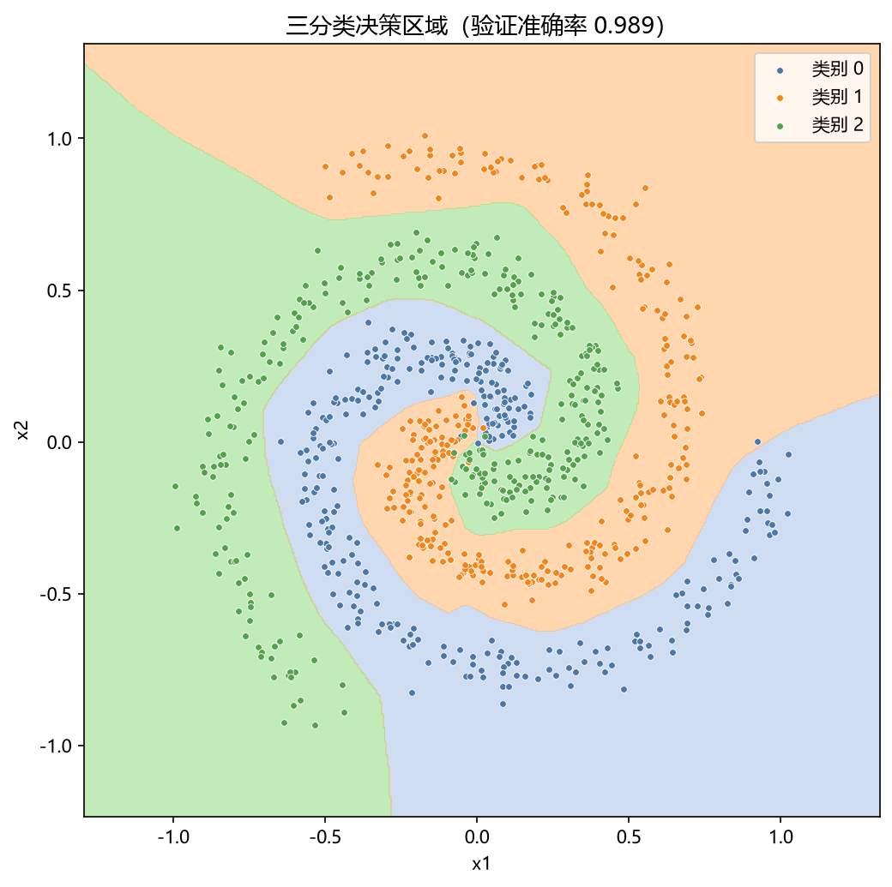
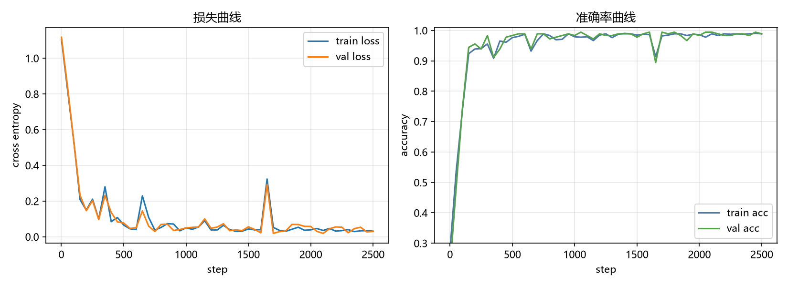

# 实验 04：手写 softmax + 交叉熵（三分类）

脚本：`scripts/04_softmax_3class.py`
代码：`src/rldl/manual_softmax.py`、`src/rldl/softmax_data.py`

实验 01 是二分类：1 个输出 → sigmoid → BCE。
这次是三分类：3 个输出 → softmax → 交叉熵。核心机制完全一样，只是从「一个概率」变成「一组概率」。

---

## 1. softmax：把 3 个分数变成 3 个概率

网络最后输出 3 个 logit，比如 `[2, 1, 0]`。它们不是概率（可正可负、和不为 1）。softmax 做两件事：

```
p_i = exp(z_i) / Σ_j exp(z_j)
```

手算 `z = [2, 1, 0]`：

```
exp(z) = [7.389, 2.718, 1.000]     和 = 11.107
p      = [0.665, 0.245, 0.090]     和 = 1
```

三个概率分别表示「属于类别 0/1/2」的置信度，且互相竞争：一个变大，另外两个必然变小。

性质：**对所有 logit 同时加一个常数，softmax 结果不变**（分子分母同乘 `e^c` 约掉）。这条性质是数值稳定实现的基础。

---

## 2. 数值稳定：为什么要先减最大值

如果直接算 `exp(1000)`，float32 会溢出成 `inf`，再除就得到 `nan`。做法是先减去每行最大值：

```python
shifted = logits - logits.max(dim=1, keepdim=True).values
log_probs = shifted - torch.log(torch.exp(shifted).sum(dim=1, keepdim=True))
```

以 `[1000, 1001, 1002]` 为例，减去 1002 后变成 `[-2, -1, 0]`，指数就是 `[0.135, 0.368, 1.0]`，完全不会溢出，结果仍是 `[0.090, 0.245, 0.665]`。

脚本每次运行都会打印验证：

```text
softmax 最大误差 = 5.96e-08
cross_entropy 误差 = 0.00e+00
大 logits 的稳定 softmax = [0.09003055840730667, 0.2447284609079361, 0.6652409434318542]
概率和 = 1.000000
```

手写实现和 PyTorch 官方结果的误差在浮点精度级别，说明公式没写错。

---

## 3. 交叉熵：只惩罚「正确类别的概率太低」

对一个样本，真实类别是 `y`，预测概率是 `p`：

```
loss = -log(p_y)
```

| 正确类别的预测概率 p_y | loss | 直觉 |
| --- | --- | --- |
| 0.99 | 0.010 | 很自信且对了，几乎不罚 |
| 0.90 | 0.105 | 小罚 |
| 0.50 | 0.693 | 不确定，明显罚 |
| 0.10 | 2.303 | 很自信但错了，重罚 |

一个 batch 的 loss 是这些 `-log(p_y)` 的平均：

```python
log_probs = log_softmax(logits)
picked = log_probs.gather(1, targets.unsqueeze(1)).squeeze(1)
return -picked.mean()
```

`gather` 的作用：从每行的 3 个 log 概率里，取出「正确类别」那一列。

为什么不用准确率当损失：准确率是 0/1 阶梯函数，几乎处处梯度为 0，没法反向传播。交叉熵是光滑的，能给出「往哪个方向改、改多少」。

---

## 4. 梯度长什么样（很漂亮）

对 softmax + 交叉熵，loss 对 logits 的梯度是：

```
dL/dz_i = p_i - y_i        （y 是 one-hot 标签）
```

例如预测 `p = [0.665, 0.245, 0.090]`，真实类别是 0：

```
梯度 = [0.665-1, 0.245-0, 0.090-0] = [-0.335, 0.245, 0.090]
```

- 正确类别的梯度是负的 → 更新后它的 logit 会被推高；
- 其他类别梯度是正的 → 它们的 logit 被压低；
- 已经预测得很准时（p≈1），梯度≈0，几乎不再更新。

这个形式比 BCE 的 `p - y` 完全一致——二分类就是三分类取 2 个类别的特例。

实际训练不需要手写这一步，`loss.backward()` 由 autograd 完成；理解它是为了知道「为什么 softmax + CE 收敛得又快又稳」。

---

## 5. 数据和模型

数据：三类螺旋（`make_spiral_3class`），三条臂互相缠绕，直线分不开。

- 每类 300 条，共 900 条
- 噪声 0.05，1 圈
- 720 训练 / 180 验证

模型：`MLPClassifier(2, 64, 3)`

```text
2 → 64 → 64 → 3
```

- 两层隐藏层，ReLU
- 输出 3 个 logit
- 参数：192 + 4160 + 195 = **4547 个**

---

## 6. 训练结果

默认参数（2500 步，batch 64，SGD lr=0.15，momentum=0.9）：

```text
final: train_acc=0.989 val_acc=0.989
final: train_loss=0.0313 val_loss=0.0299
```



颜色区域是网络判定的类别，边界由 ReLU 拼出来，所以是折线而不是平滑曲线。三条螺旋臂基本被正确分开，验证集 180 个点里错了 2 个。



曲线在 400、700、1650 步附近有尖峰，原因是：SGD + momentum、学习率 0.15、每步只有 64 条数据，偶尔一批梯度方向偏得厉害。它很快恢复，不是发散（loss 始终低于 0.35，准确率始终高于 0.9）。这也是一个直观感受：**小 batch + 大学习率 = 曲线更抖**。

---

## 7. 与实验 01 的对照

| | 二分类（实验 01） | 三分类（实验 04） |
| --- | --- | --- |
| 输出 | 1 个 logit | 3 个 logits |
| 概率 | sigmoid | softmax |
| 损失 | BCEWithLogits | 交叉熵 |
| 梯度 | p − y | p − y（one-hot） |
| PyTorch 损失函数 | `BCEWithLogitsLoss` | `CrossEntropyLoss` |

PyTorch 的 `CrossEntropyLoss` 内部已经包含了 log_softmax，所以传入的应该是 logits，不要再自己 softmax 一次。

---

## 8. 自己动手

```bash
# 默认
uv run python scripts/04_softmax_3class.py

# 数据更少：每类 100 条
uv run python scripts/04_softmax_3class.py --per-class 100

# 噪声更大：臂之间重叠
uv run python scripts/04_softmax_3class.py --noise 0.2

# 网络太小：观察欠拟合
uv run python scripts/04_softmax_3class.py --hidden 4
```

观察点：

1. 数据量减少后，val_acc 和 train_acc 的差距怎么变？
2. 噪声变大后，决策边界是否开始「穿过」数据点？
3. `--hidden 4` 时，三条臂还能分开吗？为什么参数太少会欠拟合？

---

## 9. 复现与产物

```bash
uv run python scripts/04_softmax_3class.py
```

产物在 `outputs/04_softmax_3class/`：

- `curves.png`：损失与准确率曲线
- `boundary.png`：决策区域
- `model.pth`：参数字典
- `data.npz`：数据快照

测试：`tests/test_softmax.py` 覆盖 softmax 归一化、数值稳定性、与 PyTorch 交叉熵一致性、模型形状与梯度。
