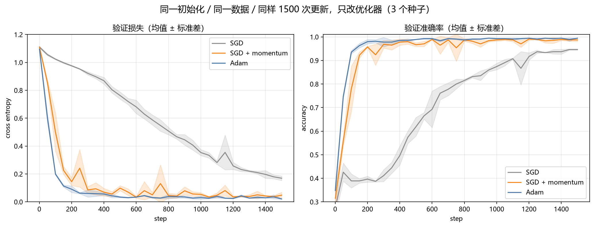

# 实验 05：手写 Adam，对比 SGD

脚本：`scripts/05_adam_vs_sgd.py`
代码：`src/rldl/manual_optim.py`
测试：`tests/test_optim.py`

---

## 1. 先把名字拆开

### SGD = Stochastic Gradient Descent（随机梯度下降）

| 单词 | 含义 |
| --- | --- |
| Stochastic | 随机的：每步只随机抽一小批数据 |
| Gradient | 梯度：loss 上升最快的方向 |
| Descent | 下降：朝反方向走，让 loss 变小 |

读作「S-G-D」。公式就是实验 01 里的：

```
w = w - lr * grad
```

### Adam = Adaptive Moment Estimation（自适应矩估计）

| 单词 | 含义 |
| --- | --- |
| Adaptive | 自适应的：每个参数有自己的步长 |
| Moment | 矩：一阶矩 = 梯度的平均，二阶矩 = 梯度平方的平均 |
| Estimation | 估计：用滑动平均去估计这两个量 |

读作「亚当」。2014 年由 Kingma 和 Ba 提出，是现在最常用的优化器。

---

## 2. SGD 与 momentum

普通 SGD 每个参数共用同一个学习率：

```
w = w - lr * g
```

加动量（PyTorch 的写法）：

```
v = momentum * v + g
w = w - lr * v
```

`v` 累积历史梯度：方向一致时越走越快，来回抖动时相互抵消。默认 `momentum=0.9`。

直觉：像一个小球下坡，保留之前的惯性。

---

## 3. Adam 在做什么

Adam 为**每个参数**单独维护两个滑动平均：

```
m = β1 * m + (1-β1) * g          # 一阶矩：梯度的平均方向
v = β2 * v + (1-β2) * g²         # 二阶矩：梯度大小的平方平均
```

`β1=0.9`，`β2=0.999`。

因为 `m`、`v` 初始是 0，训练初期会偏小，所以要**偏差修正**（t 是第几步）：

```
m̂ = m / (1 - β1^t)
v̂ = v / (1 - β2^t)
```

最后更新：

```
w = w - lr * m̂ / (√v̂ + ε)
```

关键在分母 `√v̂`：

- 某个参数的梯度一直很大 → `√v̂` 大 → 实际步长变小；
- 梯度一直很小 → `√v̂` 小 → 实际步长变大；
- 于是每个参数都按自己的「历史波动」自动缩放，不需要手动给每个参数调学习率。

`ε=1e-8` 只是防止除以 0。

---

## 4. 手写实现与验证

`src/rldl/manual_optim.py` 只有两个类：

- `SGD(params, lr, momentum)`：约 10 行核心代码
- `Adam(params, lr, betas, eps)`：约 20 行核心代码

`tests/test_optim.py` 用同一份初始模型、同一批数据，分别跑手写优化器和 `torch.optim`，
逐步比较参数，误差要求 `< 1e-7`：

```text
tests/test_optim.py ...   3 passed
```

说明手写实现与 PyTorch 的数学完全一致，不是「看起来差不多」。

---

## 5. 实验设置

| 项 | 值 |
| --- | --- |
| 数据 | 三类螺旋，900 点，720 训练 / 180 验证 |
| 模型 | `2 → 64 → 64 → 3`，4547 参数 |
| batch | 64 |
| 更新次数 | 1500 |
| 随机种子 | 3 个，画均值 ± 标准差 |
| 学习率 | SGD 0.1；SGD+momentum 0.15；Adam 0.01 |

学习率不能三种共用：SGD 的梯度尺度大，Adam 会自动归一化，两者合适的学习率差一个量级左右。这里给每种优化器取一个合理值，属于「各自调过再比」。

---

## 6. 结果

| 优化器 | 最终 val_acc | 最终 val_loss | 达到 0.95 所需步数 |
| --- | --- | --- | --- |
| SGD | 0.9463 ± 0.0026 | 0.1694 ± 0.0165 | ~1400 |
| SGD + momentum | 0.9870 ± 0.0069 | 0.0477 ± 0.0212 | 200 |
| **Adam** | **0.9944 ± 0.0000** | **0.0206 ± 0.0020** | **150** |



三个现象很清楚：

1. **Adam 起步最快**：150 步就到 0.95，曲线几乎笔直上升；
2. **momentum 紧随其后**：200 步到 0.95，最终 0.987；
3. **普通 SGD 最慢**：1400 步才到 0.95，最终只有 0.946，曲线还在缓慢下降。

原因：螺旋数据的梯度在不同区域尺度差异很大，SGD 用一个全局学习率很难同时兼顾；Adam 给每个参数单独缩放，所以早期推进快得多。Adam 的方差带几乎看不见，说明 3 个种子结果高度一致。

---

## 7. 但别得出「Adam 永远更好」的结论

这个实验是短训练（1500 步）+ 小模型 + 尺度差异大的数据，正好是 Adam 的主场。实际工程里还有几点：

- **显存**：Adam 每个参数多存 `m`、`v` 两份状态，显存约为 SGD 的 3 倍；
- **最终精度**：训练足够久、学习率调度调好的 SGD + momentum，在图像分类等任务上有时泛化更好；
- **权重衰减**：Adam 的 L2 与自适应步长耦合，通常用 **AdamW**（decoupled weight decay）代替；
- **学习率**：Adam 对 lr 不敏感，但不是不需要调，太大同样会震荡。

经验法则：

| 场景 | 常用选择 |
| --- | --- |
| 快速原型、不确定超参 | Adam / AdamW |
| Transformer、稀疏梯度 | Adam / AdamW |
| 视觉任务、追求最终精度、训练充分 | SGD + momentum + 学习率调度 |
| 强化学习（DQN/PPO 等） | 多数实现用 Adam |

---

## 8. 自己动手

```bash
# 默认：3 个种子
uv run python scripts/05_adam_vs_sgd.py

# Adam 学习率过大：观察震荡/发散
uv run python scripts/05_adam_vs_sgd.py --lr-adam 0.5

# 纯 SGD 学习率过大
uv run python scripts/05_adam_vs_sgd.py --lr-sgd 1.0

# 更多种子，方差更可信
uv run python scripts/05_adam_vs_sgd.py --seeds 5
```

观察点：

1. Adam 的 lr 从 0.01 提到 0.5，曲线会怎样？
2. 普通 SGD 的 lr 调大后，能否追上 momentum？
3. 训练步数增加到 5000，SGD 的最终精度会不会接近 Adam？

---

## 9. 产物与复现

```bash
uv run python scripts/05_adam_vs_sgd.py
```

- `outputs/05_adam_vs_sgd/adam_vs_sgd.png`：对比曲线
- `outputs/05_adam_vs_sgd/history.npz`：均值/方差原始数据
- `docs/images/05_adam_vs_sgd.png`：文档用图
