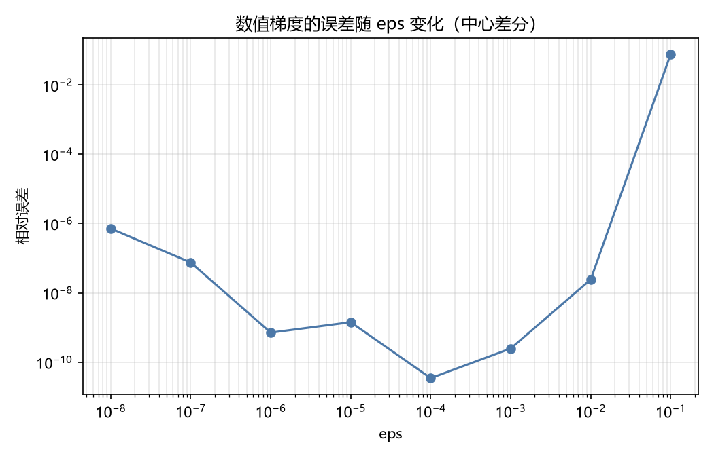

# 实验 08：数值梯度检查

脚本：`scripts/08_numerical_gradient.py`
工具：`src/rldl/gradcheck.py`
测试：`tests/test_gradcheck.py`

---

## 1. 要验证什么

训练时我们调用 `loss.backward()`，PyTorch 自动算出每个参数的梯度。但它到底算得对不对？

梯度就是导数。导数的定义：

```text
f'(w) = lim   [f(w+ε) - f(w)]
        ε→0        ε
```

既然定义里就是「变化量除以变化量」，那我们完全可以**手动把参数加一点、减一点，看 loss 变多少**，用这个商去近似导数。这就是数值梯度。

如果手算的数值梯度和 autograd 的结果几乎相同，说明反向传播是对的。

---

## 2. 中心差分

脚本用的是中心差分：

```text
数值梯度 = [L(w+ε) - L(w-ε)] / (2ε)
```

比「前向差分」`[L(w+ε)-L(w)]/ε` 更准。用泰勒展开看：

```text
L(w+ε) = L + εL' + ε²/2·L'' + ε³/6·L''' + ...
L(w-ε) = L - εL' + ε²/2·L'' - ε³/6·L''' + ...
```

两式相减，`L` 和 `ε²` 项都抵消：

```text
[L(w+ε) - L(w-ε)] / (2ε) = L' + O(ε²)
```

前向差分只能消到 `O(ε)`。中心差分的误差随 `ε²` 缩小，所以更精确。

---

## 3. 代码怎么写

`src/rldl/gradcheck.py` 里只有两个函数：

```python
def numerical_gradients(params, loss_fn, eps=1e-5):
    for p in params:
        for 每个元素 i:
            p[i] += eps   → 算 loss_plus
            p[i] -= 2*eps → 算 loss_minus
            p[i] 还原
            grad[i] = (loss_plus - loss_minus) / (2 * eps)
```

要点：

- 用 **float64**，float32 的舍入误差会淹没差分；
- 每次只扰动一个参数，其他保持不变；
- `loss_fn` 只做前向，不调用 `backward()`。

然后拿它和 `p.grad` 逐元素比，算相对误差。

---

## 4. 实验结果

### 4.1 一维函数

`L(w) = w³ + 2w²`，在 `w=1` 处解析梯度 `3w²+4w = 7`。

```text
解析梯度（autograd） = 7.0000000000
数值梯度（eps=1e-05） = 7.0000000001
相对误差 = 1.61e-11
```

### 4.2 一个小网络

`2 → 8 → 3`，32 条样本，共 123 个参数，全部逐个检查：

```text
eps = 1e-4：最大相对误差 1.26e-02
eps = 1e-5：最大相对误差 7.35e-08
```

`eps=1e-5` 时误差在 `1e-8` 量级，说明 autograd 的梯度是正确的。

`eps=1e-4` 时误差突然变大，不是 autograd 错了，而是 **ReLU 的折点**：

- ReLU 在 0 处不可导，左边导数是 0，右边是 1；
- 如果某个神经元的输入原本在 0 附近，`w±ε` 正好跨过折点，中心差分会把两边的斜率平均；
- autograd 在折点取的是其中一个（次梯度），两者自然不一致；
- 把 `ε` 调小（跨过的概率降低）或者换平滑激活函数（tanh）就能避免。

这也是数值梯度检查的实用经验：**误差突然变大时，先怀疑不可导点，再怀疑代码**。

### 4.3 ε 太大或太小都不行

固定 `fc1.weight[0,0]`，扫描不同的 `ε`：

| eps | 相对误差 |
| --- | --- |
| 1e-1 | 7.74e-02 |
| 1e-2 | 2.42e-08 |
| 1e-3 | 2.48e-10 |
| 1e-4 | 3.46e-11 |
| 1e-5 | 1.42e-09 |
| 1e-6 | 7.11e-10 |
| 1e-7 | 7.53e-08 |
| 1e-8 | 7.15e-07 |



两边误差都会上升：

- `ε` 太大：泰勒展开的高阶项不能忽略，**截断误差** `O(ε²)` 变大；
- `ε` 太小：两个几乎相等的数相减，浮点有效位丢失，**舍入误差** `O(1/ε)` 变大。

所以是一条 U 形曲线。float64 下，`ε` 取 `1e-5 ~ 1e-4` 比较合适；float32 下要取 `1e-2 ~ 1e-3`。

---

## 5. 为什么不直接用数值梯度训练

数值梯度很慢：

- 每个参数要 **2 次前向**；
- 123 个参数 → 246 次前向；
- 实验 01 的网络有 1185 个参数 → 2370 次前向；
- 而反向传播只要 **1 次前向 + 1 次反向**，就得到全部梯度。

所以数值梯度只用来**检查**，不用来训练。实际训练靠 autograd，检查时抽样几个参数即可（大模型不必全查）。

---

## 6. 实践建议

1. 用 float64 做检查；
2. `eps` 从 `1e-4` 开始，误差大就试 `1e-5`、`1e-6`；
3. 相对误差的正常量级是 `1e-8 ~ 1e-6`；`1e-2` 以上要查原因；
4. 梯度接近 0 的参数，相对误差会被放大，这时看绝对误差更合理；
5. ReLU / max / abs 等不可导点会造成偶发误差，换 `eps` 或换 seed 复测；
6. 大模型只抽查若干参数，或把网络缩小后整体检查。

---

## 7. 复现

```bash
uv run python scripts/08_numerical_gradient.py
uv run pytest tests/test_gradcheck.py -v
```

产物：`outputs/08_numerical_gradient/epsilon_sweep.png`。

结论：**autograd 的梯度与独立实现的数值梯度在 `1e-8` 量级内一致**，可以放心用 `loss.backward()`。
