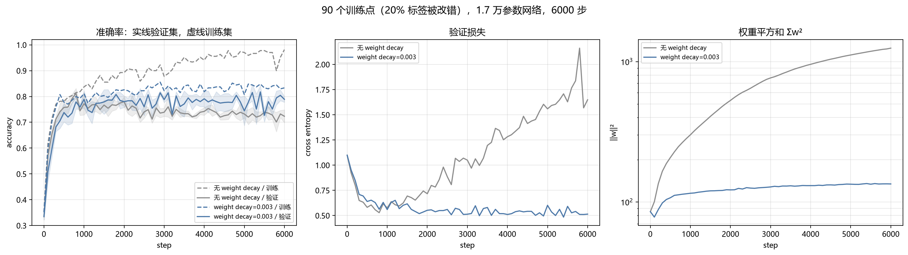
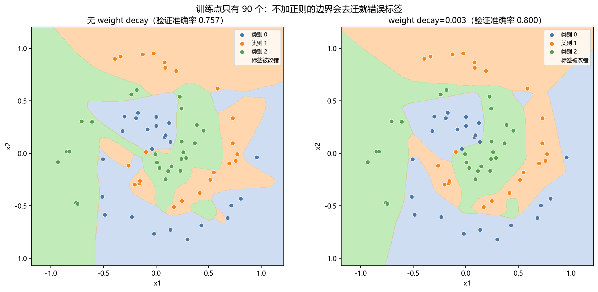

# 实验 09：过拟合与 weight decay

脚本：`scripts/09_weight_decay.py`
图：`docs/images/09_curves.png`、`docs/images/09_boundary.png`

## 1. 什么是过拟合

训练集上表现很好，验证集上表现差——模型把训练数据「背下来」了，而不是学到规律。

正常训练：

```text
训练准确率 ↑    验证准确率 ↑    两者接近
```

过拟合：

```text
训练准确率 ↑↑   验证准确率停滞甚至 ↓   差距越来越大
```

这次故意制造一个容易过拟合的场景：

- 每类只给 **30 个训练点**，共 90 个；
- 其中 **20% 的标签被故意改错**（18 个）；
- 验证集每类 100 个，共 300 个，标签干净；
- 网络 `2 → 128 → 128 → 3`，约 **1.7 万参数**；
- 训练 6000 步。

1.7 万个参数去拟合 90 个点，绰绰有余，连错误标签也能一起背下来。

## 2. weight decay 是什么

在损失里加一项「权重的平方和」：

```text
loss = 交叉熵 + 0.5 × wd × Σ w²
```

`wd` 是权重衰减系数。梯度会多出一项：

```text
dL/dw = 交叉熵梯度 + wd × w
```

更新就变成：

```text
w ← w - lr × (交叉熵梯度 + wd × w)
```

多出来的 `- lr × wd × w` 每一步都把权重往 0 拉一点，所以叫 **weight decay（权重衰减）**。权重变小，网络输出的变化就更平缓，不容易为了迁就个别噪声点而剧烈弯折。

实现细节：

- 只惩罚权重 `fc*.weight`，不惩罚偏置 `fc*.bias`（常见做法）；
- `wd=0` 表示不加正则；
- 这里的写法和 L2 正则完全等价（对普通 SGD 而言）。

## 3. 结果（3 个种子均值）

| weight decay | 训练准确率 | 验证准确率 | Σw² |
| --- | --- | --- | --- |
| 0 | **0.981** | 0.723 | 1248 |
| 3e-3 | 0.833 | **0.789** | 134 |



三条曲线分别说明：

1. **准确率**：不加正则时，训练集升到 0.98，验证集卡在 0.72；加了正则后训练集降到 0.83，验证集反而升到 0.79。训练变差、验证变好，正是正则化想要的效果。
2. **验证损失**：不加正则的验证损失从 0.5 一路涨到 2.0 以上，而训练损失还在降——这是过拟合最典型的信号。加正则后验证损失稳定在 0.5 左右。
3. **Σw²**：不加正则时权重平方和涨到 1200 以上，加正则后只有 134。参数被压小了 10 倍。



- 左边（无正则）：边界出现了小岛和尖角，专门去迁就那些被改错的标签；
- 右边（weight decay）：边界更平滑，放弃少数错误点，换来整体更好的验证准确率。

## 4. 为什么有效

模型容量 = 它能表达多复杂的函数。权重越大，ReLU 折线越陡，边界可以弯得越厉害，越容易「记住」每个点。

weight decay 把权重压小，相当于限制模型的弯曲能力：

- 个别噪声点不再值得为它拐一个大弯；
- 边界更平滑，对没见过的点更稳；
- 代价是训练集准确率下降——这是正常的，我们关心的是验证集。

## 5. wd 太大会怎样

`wd` 不是越大越好：

- 太小（如 1e-5）：几乎没效果；
- 合适（如 1e-3 ~ 3e-3）：验证集提升；
- 太大（如 1e-2 以上）：权重被压到接近 0，模型欠拟合，训练和验证都变差；
- 极端情况：所有权重变成 0，输出恒定，准确率退化成 1/3。

所以它和学习率一样，是需要调的超参数。

## 6. 与 Adam 的关系

对普通 SGD，在 loss 里加 `0.5·wd·Σw²` 就是标准的 L2 正则。

但 Adam 的自适应步长会把 L2 梯度也归一化，导致正则效果被削弱、和 SGD 的行为不一致。实际用 Adam 时更常用 **AdamW**：把 weight decay 从梯度里拿出来，单独做 `w ← w - lr·wd·w`，称为「解耦权重衰减」。

本项目为了看清原理，用的是 SGD + 在 loss 里加 L2 的写法。

## 7. 自己动手

```bash
# 默认对比
uv run python scripts/09_weight_decay.py

# 把错误标签比例提高到 30%
uv run python scripts/09_weight_decay.py --flip 0.3

# 正则太强，观察欠拟合
uv run python scripts/09_weight_decay.py --wd 0.01

# 网络小一点，过拟合会减轻
uv run python scripts/09_weight_decay.py --hidden 32

# 不加标签噪声，对比过拟合程度
uv run python scripts/09_weight_decay.py --flip 0
```

观察点：

1. `--flip 0` 时，两种设置的验证准确率还差多少？
2. `--wd 0.01` 时，训练准确率会不会掉到 0.6 以下？
3. 把 `--hidden` 改小，是否不需要正则也能取得差不多的验证准确率？

## 8. 复现与产物

```bash
uv run python scripts/09_weight_decay.py
```

- `outputs/09_weight_decay/curves.png`：准确率、验证损失、权重范数
- `outputs/09_weight_decay/boundary.png`：两种设置的决策边界
- `outputs/09_weight_decay/history.npz`：原始曲线数据

结论：**过拟合的表现是训练集和验证集分道扬镳；weight decay 通过压小权重限制模型容量，用一点训练准确率换回验证准确率。**
