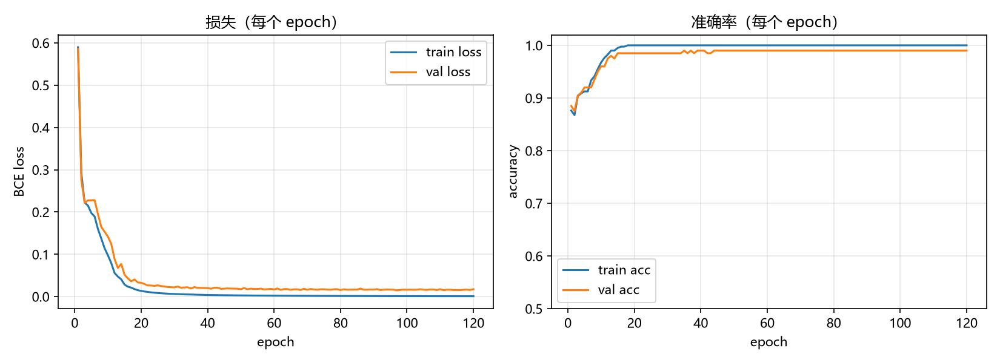

# 实验 10：用 nn.Module / Dataset / DataLoader 重写实验 01

脚本：`scripts/10_nn_module_mlp.py`
图：`docs/images/10_nn_module_curves.png`

任务和实验 01 完全一样：two-moons 二分类。区别是换成 PyTorch 的标准工程写法。

## 1. 四处改动

### ① 模型：手写 Linear → nn.Module

实验 01 里每一层都是自己写的类；现在：

```python
class BinaryMLP(nn.Module):
    def __init__(self, in_features=2, hidden=32):
        super().__init__()
        self.net = nn.Sequential(
            nn.Linear(in_features, hidden),
            nn.ReLU(),
            nn.Linear(hidden, hidden),
            nn.ReLU(),
            nn.Linear(hidden, 1),
        )

    def forward(self, x):
        return self.net(x)
```

好处：

- `model.parameters()` 自动收集所有参数；
- `model.to(device)` 一次搬完；
- `model.train()` / `model.eval()` 自动切换 Dropout、BatchNorm 等层的行为；
- `model.state_dict()` 直接保存/加载。

### ② 数据：手动抽 batch → Dataset + DataLoader

```python
class ArrayDataset(Dataset):
    def __len__(self): return len(self.X)
    def __getitem__(self, i): return self.X[i], self.y[i]

train_loader = DataLoader(train_ds, batch_size=64, shuffle=True)
```

DataLoader 负责：

- 每个 epoch 自动打乱（`shuffle=True`）；
- 按 `batch_size` 切分，最后一批不足 64 就保留（这里是 32）；
- 把多条样本拼成 `(64, 2)` 的张量（collate）；
- 需要时可以多进程加载、自定义采样器。

这和我们实验 03 讨论的「无放回」完全一致：一个 epoch 里每条数据恰好出现一次。

### ③ 训练：按 step 循环 → 按 epoch 循环

```python
for epoch in range(1, epochs + 1):
    model.train()
    for xb, yb in train_loader:
        logits = model(xb).squeeze(1)
        loss = criterion(logits, yb)
        optimizer.zero_grad(set_to_none=True)
        loss.backward()
        optimizer.step()
```

外层是 epoch，内层是 batch。800 条 ÷ 64 = 12 个满 batch + 1 个 32 条，所以 **13 步一个 epoch**。

### ④ 评估：model.eval() + torch.no_grad()

```python
model.eval()
with torch.no_grad():
    for xb, yb in val_loader:
        ...
```

- `eval()` 关闭 Dropout、冻结 BatchNorm 的统计量；
- `no_grad()` 不建计算图，省显存、更快；
- 评估完下一轮训练前要 `model.train()` 切回来。

这个任务里没有 Dropout/BatchNorm，`eval()` 暂时不影响结果，但后面 CNN 必须要养成习惯。

## 2. 结果

```text
train = 800, val = 200, batch = 64, steps/epoch = 13

epoch   1 | train_acc=0.876 val_acc=0.885
epoch  20 | train_acc=1.000 val_acc=0.985
epoch 120 | train_acc=1.000 val_acc=0.990

final: train_acc=1.000 val_acc=0.990
total updates = 1560
```



训练集在 20 个 epoch 内到 1.0，验证集稳定在 0.99。验证损失在 60 个 epoch 后从 0.0155 缓慢升到 0.0174，训练损失还在降——轻微的过拟合，但准确率没有下降，可以接受。

## 3. 与实验 01 的对比

| | 实验 01（手写） | 实验 10（标准写法） |
| --- | --- | --- |
| 模型 | 手写 Linear/ReLU | `nn.Sequential` |
| 参数量 | 1185 | 1185 |
| 数据 | `randint` 有放回抽 64 条 | DataLoader 无放回，最后一批 32 条 |
| 循环 | 1500 个 step | 120 epoch × 13 step = 1560 次更新 |
| 评估频率 | 每 50 步 | 每 epoch |
| 最终 val_acc | 0.995 | 0.990 |
| 保存 | 手写 state_dict | `model.state_dict()` |

两者参数量完全相同，结果在同一水平。0.995 与 0.990 的差异来自采样方式、评估频率和训练步数，不是写法优劣。

## 4. 四个常见坑

1. **忘记 `optimizer.zero_grad()`**：梯度累加，训练会乱。
2. **验证时忘记 `model.eval()` / `torch.no_grad()`**：有 Dropout/BN 时结果不对，还浪费显存。
3. **以为最后一批也是 64 条**：800 ÷ 64 = 12.5，最后一个 batch 只有 32 条，形状相关代码要小心。
4. **加载 `state_dict` 时结构不一致**：必须先建同样的 `BinaryMLP(2, 32)`，再 `load_state_dict`，否则键名/形状对不上。

## 5. 自己动手

```bash
# 默认
uv run python scripts/10_nn_module_mlp.py

# 更小的 batch：25 步一个 epoch，曲线更抖
uv run python scripts/10_nn_module_mlp.py --batch-size 32

# 训练不够：观察欠拟合
uv run python scripts/10_nn_module_mlp.py --epochs 10

# 数据更难
uv run python scripts/10_nn_module_mlp.py --noise 0.25
```

观察点：

1. `--batch-size 32` 时，一个 epoch 多少步？验证准确率到 0.99 需要几个 epoch？
2. `--epochs 10` 时，训练和验证损失停在哪里？
3. 把 `shuffle` 改成 `False`，曲线会有什么变化？

## 6. 下一步

这套结构会直接用在 MNIST CNN 上：

- `Dataset` 换成 `torchvision.datasets.MNIST`；
- `BinaryMLP` 换成卷积网络；
- 训练循环、评估、保存基本不变。

从实验 11 开始进入 CNN。
