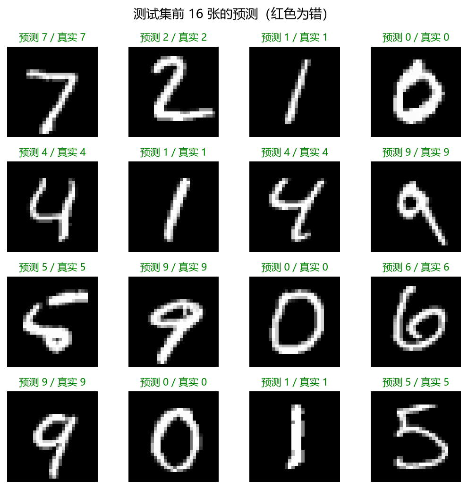
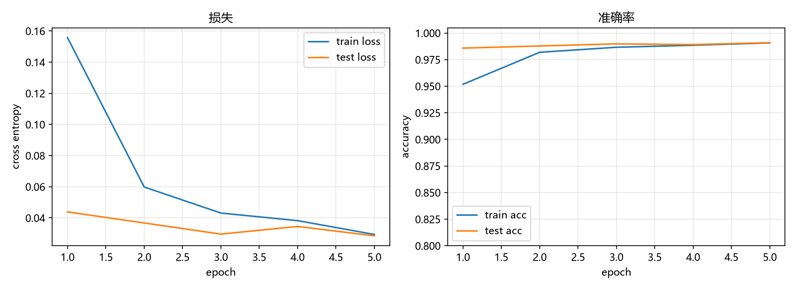
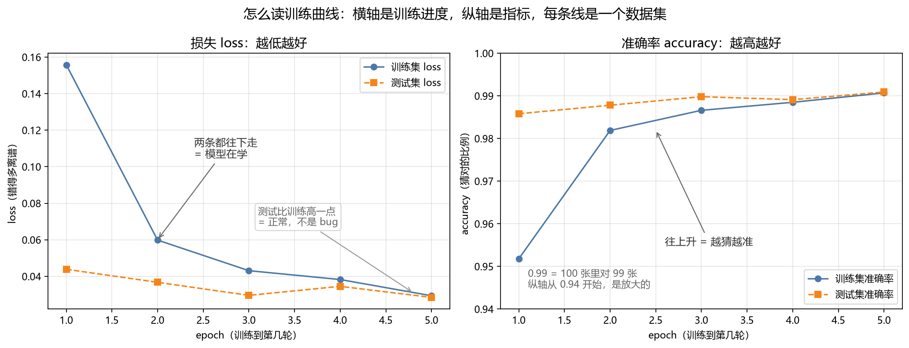

# 实验 11：MNIST 手写数字识别（CNN）

脚本：`scripts/11_mnist_cnn.py`
数据：`data/mnist/`（首次运行自动下载，约 11 MB，不入库）
图：`docs/images/11_curves.png`、`docs/images/11_predictions.png`

---

## 1. MNIST 是什么

机器学习里的「Hello World」：

- **70000 张**手写数字图片，每张 **28×28 灰度**；
- 像素值 0（黑）到 255（白）；
- 标签是 0~9 中的一个数字；
- 官方划分：**60000 张训练 + 10000 张测试**。



模型看到的就是左边这样的黑白小图，要输出它到底是几。

---

## 2. 为什么不用全连接网络

如果把 28×28 拉平成一个 784 维向量，接一个 128 维隐藏层：

```text
784 × 128 + 128 = 100480 个参数
```

问题：

1. 参数多，容易过拟合；
2. 丢失了二维结构——相邻像素的关系被拍平了；
3. 数字稍微平移几个像素，输入向量就完全不同，全连接层很难适应。

CNN（卷积神经网络）用三个办法解决：**局部连接、权重共享、池化**。

---

## 3. CNN 的三个核心操作

### ① 卷积（Convolution）

拿一个小的滤波器（比如 3×3），在图片上从左到右、从上到下滑动，每个位置算一次加权和：

```text
输出(i,j) = Σ 输入(i+di, j+dj) × 滤波器(di,dj)
```

- 一个滤波器学会检测一种局部模式（横线、竖线、圆弧……）；
- 用 32 个滤波器，就得到 32 张「特征图」；
- **同一个滤波器扫过整张图**（权重共享），所以参数很少，而且数字平移后仍能被检测到。

### ② 池化（Pooling）

每 2×2 区域取最大值，把 28×28 变成 14×14：

- 减少计算量；
- 保留最强响应，对小幅平移更宽容。

### ③ 全连接（Fully Connected）

卷积层提取特征，最后把 64 张 7×7 的特征图展平成 3136 维，接全连接层分类到 10 类。

---

## 4. 模型结构与形状

```text
输入            (N, 1, 28, 28)
Conv 3×3, 32    (N, 32, 28, 28)
BatchNorm + ReLU
MaxPool 2×2     (N, 32, 14, 14)
Conv 3×3, 64    (N, 64, 14, 14)
BatchNorm + ReLU
MaxPool 2×2     (N, 64, 7, 7)
Flatten         (N, 3136)
Linear 128      (N, 128)
ReLU + Dropout(0.25)
Linear 10       (N, 10)   → 10 个类别的 logit
```

参数量：

| 层 | 参数 |
| --- | --- |
| Conv1 1→32 | 1×32×3×3 + 32 = 320 |
| BatchNorm1 | 64 |
| Conv2 32→64 | 32×64×3×3 + 64 = 18496 |
| BatchNorm2 | 128 |
| Linear 3136→128 | 401536 |
| Linear 128→10 | 1290 |
| **合计** | **421834** |

大部分参数集中在第一个全连接层。

### BatchNorm 和 Dropout 的作用

- **BatchNorm**：把每层输出标准化到相近尺度，训练更稳、可以用更大学习率；
- **Dropout(0.25)**：训练时随机丢掉 25% 的神经元，防止过拟合；评估时自动关闭。

---

## 5. 数据加载

本项目没有用 `torchvision`，而是自己下载并解析原始 IDX 文件：

- 图像文件头：magic=2051，然后是数量、行数、列数，后面是像素；
- 标签文件头：magic=2049，然后是数量，后面是标签；
- 用 gzip 解压 + `np.frombuffer` 读取。

来源依次尝试三个镜像，国内优先：

```text
dataset.bj.bcebos.com/mnist/
storage.googleapis.com/cvdf-datasets/mnist/
ossci-datasets.s3.amazonaws.com/mnist/
```

归一化用 MNIST 的统计量：

```text
x = (像素/255 - 0.1307) / 0.3081
```

让输入大致落在 -0.5 ~ 2.5 之间，训练更稳定。

---

## 6. 训练设置

| 项 | 值 |
| --- | --- |
| 损失 | 交叉熵（10 类） |
| 优化器 | Adam，lr=1e-3 |
| batch | 128 |
| epoch | 5 |
| 设备 | RTX 4050 Laptop |
| 总耗时 | 约 16 秒 |

每个 epoch 469 个 batch。

## 7. 结果

```text
epoch 1 | train acc=0.9518 | test acc=0.9858
epoch 2 | train acc=0.9819 | test acc=0.9878
epoch 3 | train acc=0.9866 | test acc=0.9898
epoch 4 | train acc=0.9885 | test acc=0.9891
epoch 5 | train acc=0.9907 | test acc=0.9909
```

**最佳测试准确率 0.9909**，达到 ≥0.99 的目标：10000 张测试图里错了约 91 张。



### 怎么读这些曲线



- **横轴 epoch**：训练到第几轮，越大表示训练越久；
- **纵轴 loss**：错得多离谱，越低越好；
- **纵轴 accuracy**：猜对的比例，越高越好；
- **每条线**：在一个数据集上的表现，蓝色是训练集，橙色是测试集；
- **两条线的差距**：差距越大，泛化越差。

常见的四种形状：

| 形状 | 含义 |
| --- | --- |
| 两条 loss 一起下降，acc 一起上升 | 正常，模型在学 |
| 训练 loss 降，测试 loss 升 | 过拟合 |
| 两条都降不下去 | 欠拟合 / 学习率太小 / 有 bug |
| 曲线剧烈上下跳 | 学习率太大或 batch 太小 |

> 注意纵轴范围。MNIST 的 acc 图从 0.94 开始，所以 0.985 → 0.990 看起来像很大的上升；如果从 0 开始画，几乎是一条平线。看具体数值，不要只看斜率。

### 为什么训练准确率一度低于测试准确率

第 1 个 epoch：训练 0.9518，测试 0.9858，看起来很奇怪。原因是：

- 训练准确率是在 `model.train()` 模式下统计的，**Dropout 正在随机丢神经元**，模型表现被削弱；
- 测试是在 `model.eval()` 模式下，Dropout 关闭，BatchNorm 用固定统计量。

到第 5 个 epoch，两者收敛到同一水平。这不是数据泄漏，也不是评估写错。

---

## 8. 常见坑

1. **忘记归一化**：像素 0~255 直接进网络，收敛很慢。
2. **忘记 `model.eval()`**：Dropout 还在随机丢神经元，测试结果偏低且不稳定。
3. **把测试集当验证集调参**：严格做法是从训练集切一部分做验证，最后只在测试集评估一次；这里为了和 MNIST 惯例一致，直接用测试集监控。
4. **在 CPU 上训练**：这个模型 CPU 也能跑，但会慢十几倍。

---

## 9. 自己动手

```bash
# 默认 5 个 epoch
uv run python scripts/11_mnist_cnn.py

# 训练更久，看能否到 0.992+
uv run python scripts/11_mnist_cnn.py --epochs 10

# 学习率太大，观察震荡
uv run python scripts/11_mnist_cnn.py --lr 0.01

# 小 batch，曲线更抖
uv run python scripts/11_mnist_cnn.py --batch-size 32

# 快速冒烟（只用 5000 张）
uv run python scripts/11_mnist_cnn.py --limit-train 5000 --epochs 1
```

观察点：

1. `--epochs 10` 时测试准确率还能涨多少？有没有过拟合？
2. `--lr 0.01` 的曲线和默认相比抖不抖？
3. 去掉 BatchNorm 或 Dropout（改 `src/rldl/cnn.py`），结果差多少？

---

## 10. 产物

```text
outputs/11_mnist_cnn/curves.png        # 损失/准确率曲线
outputs/11_mnist_cnn/predictions.png   # 前 16 张测试图的预测
outputs/11_mnist_cnn/model.pth         # 最佳模型参数
outputs/11_mnist_cnn/history.npz       # 每个 epoch 的指标
```

下一项：TensorBoard 记录训练过程 + 实验配置化，然后进入强化学习阶段。
