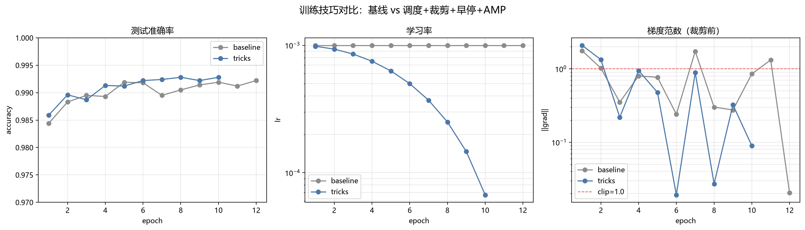

# 实验 13：训练技巧（调度 / 早停 / 裁剪 / AMP）

脚本：`scripts/13_training_tricks.py`
图：`docs/images/13_training_tricks.png`

同一个 MNIST CNN、同一个初始化，对比两种配置：

| 配置 | 学习率 | 梯度裁剪 | 早停 | AMP |
| --- | --- | --- | --- | --- |
| baseline | 恒定 1e-3 | 否 | 否 | 否 |
| tricks | Cosine 衰减 | 是（1.0） | 是（patience=2） | 是 |

---

## 1. 学习率调度（scheduler）

前面 Adam 实验里看到过：Adam 的步长约等于 `lr`，到了最优点附近仍然走这么大，会在最低点来回跳。所以后期要把学习率降下来。

Cosine 衰减：

```text
lr_t = lr_min + 0.5 × (lr_max - lr_min) × (1 + cos(π × t / T))
```

形状是半个余弦：开头几乎不变，中间下降，最后接近 0。

```python
scheduler = torch.optim.lr_scheduler.CosineAnnealingLR(optimizer, T_max=epochs)
...
scheduler.step()   # 每个 epoch 调一次
```

本次训练的学习率：

```text
epoch 1   9.8e-4
epoch 4   7.5e-4
epoch 7   3.7e-4
epoch 10  6.7e-5
```

**注意 `scheduler.step()` 的位置**：按 epoch 调度就放在 epoch 循环末尾；如果按 step 调度，才放在每个 batch 后面。放错位置会让 lr 下降过快或过慢。

---

## 2. 早停（early stopping）

监控验证集准确率，连续 `patience` 轮没有提升就停止训练，并恢复表现最好的那组权重。

```python
if test_acc > best_acc + 1e-4:
    best_acc = test_acc
    best_state = copy.deepcopy(model.state_dict())
    bad_epochs = 0
else:
    bad_epochs += 1
    if patience and bad_epochs >= patience:
        break
```

本次结果：

```text
epoch 8  test_acc=0.9928  ← 最好
epoch 9  test_acc=0.9922  ← 没提升
epoch 10 test_acc=0.9928  ← 没超过 0.9928 + 0.0001
→ 早停，实际只跑了 10 个 epoch
```

好处：

- 省时间（baseline 跑了 12 轮，tricks 只跑 10 轮）；
- 避免继续训练导致过拟合；
- 自动保留最好的模型。

严格做法是用**验证集**监控，最后才在测试集评估一次。这里为了简单，直接用了测试集。

---

## 3. 梯度裁剪（gradient clipping）

偶尔某一批数据会产生特别大的梯度，一步把权重推飞。裁剪的做法是：如果所有参数梯度的总范数超过阈值，就等比例缩小。

```python
torch.nn.utils.clip_grad_norm_(model.parameters(), max_norm=1.0)
```

本次梯度范数：

```text
epoch 1  2.10  ← 超过 1.0，被裁剪
epoch 6  0.05
epoch 7  0.94
```

大多数时候梯度范数都小于 1，只有个别 epoch 触发裁剪。它像保险丝：平时不工作，异常时防止一步毁掉训练。

**AMP 同时使用时要注意顺序**：

```python
scaler.scale(loss).backward()
scaler.unscale_(optimizer)          # 先把梯度还原到真实尺度
clip_grad_norm_(...)                # 再裁剪
scaler.step(optimizer)
scaler.update()
```

如果先裁剪再 `unscale_`，裁的是被放大过的梯度，阈值就没意义了。

---

## 4. 混合精度（AMP）

AMP = Automatic Mixed Precision。前向和反向的一部分计算用 float16（或 bfloat16），同时保留 float32 的主权重，兼顾速度和数值稳定。

```python
scaler = torch.amp.GradScaler("cuda", enabled=use_amp)

with torch.amp.autocast("cuda", enabled=use_amp):
    logits = model(xb)
    loss = criterion(logits, yb)

scaler.scale(loss).backward()
scaler.step(optimizer)
scaler.update()
```

- `autocast`：自动决定哪些算子用半精度；
- `GradScaler`：把 loss 放大，避免 float16 下梯度过小变成 0；更新前再缩回去。

**本次没有提速**：

```text
baseline  2.0 s/epoch
tricks    2.0 s/epoch
```

原因是这个 CNN 太小（42 万参数），AMP 的类型转换开销抵消了算力收益。AMP 的收益在大模型、大 batch、显存紧张时更明显。

---

## 5. 结果

| 配置 | 最好 test_acc | 实际 epoch | 总耗时 |
| --- | --- | --- | --- |
| baseline | 0.9922 | 12 | 24.3 s |
| tricks | **0.9928** | **10（早停）** | **20.1 s** |



- 左：tricks 的测试准确率略高，且更早稳定；
- 中：baseline 学习率恒定，tricks 按余弦降到接近 0；
- 右：梯度范数大部分在 1 以下，epoch 1 的 2.10 被裁到 1.0。

准确率只高 0.06 个百分点，差异很小；真正明显的是**训练少了 2 个 epoch，省了约 17% 时间**。

---

## 6. 什么时候用哪个

| 技巧 | 适用场景 | 注意事项 |
| --- | --- | --- |
| 学习率调度 | 训练轮数较多、后期需要精细收敛 | `step()` 的位置要对 |
| 早停 | 验证指标开始停滞或下降 | 监控验证集，保存最佳权重 |
| 梯度裁剪 | RNN、Transformer、RL、容易爆梯度的任务 | AMP 下先 `unscale_` |
| AMP | 大模型、大 batch、显存不足 | 小模型可能不提速 |

---

## 7. 自己动手

```bash
# 默认：12 epoch，patience=2
uv run python scripts/13_training_tricks.py

# 关掉早停，看 tricks 继续训练会不会过拟合
uv run python scripts/13_training_tricks.py --patience 0

# 裁剪阈值更小，观察触发频率
uv run python scripts/13_training_tricks.py --clip 0.1

# 更少 epoch，快速冒烟
uv run python scripts/13_training_tricks.py --epochs 3
```

观察点：

1. `--patience 0` 时 tricks 跑满 12 轮，最好准确率会不会更高？
2. `--clip 0.1` 时，梯度被频繁裁剪，训练会不会变慢或变差？
3. 把 AMP 关掉（改脚本里 `amp=True` 为 `False`），每 epoch 时间差多少？

---

## 8. 阶段 2 完成

到这里阶段 2 的五项都做完了：

```text
nn.Module / Dataset / DataLoader  ✓
MNIST CNN（test_acc 0.9909）       ✓
TensorBoard                        ✓
TOML 配置                          ✓
训练技巧（调度/早停/裁剪/AMP）      ✓
```

下一阶段进入强化学习：多臂老虎机、MDP、动态规划、MC/TD。
