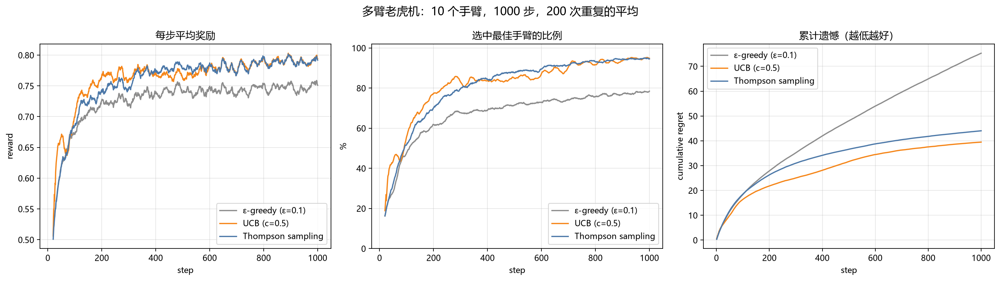

# 实验 14：多臂老虎机（ε-greedy / UCB / Thompson）

脚本：`scripts/14_bandit.py`
代码：`src/rldl/bandit.py`
图：`docs/images/14_bandit.png`

---

## 1. 强化学习是什么

和监督学习最大的区别：

| | 监督学习 | 强化学习 |
| --- | --- | --- |
| 输入 | 数据 + 正确答案 | 状态 |
| 反馈 | 每个样本都有标签 | 动作之后才有一个奖励，而且可能延迟 |
| 目标 | 预测标签 | 长期总奖励最大 |
| 关键难题 | 泛化 | **探索 vs 利用** |

强化学习的四个词：

```text
智能体 agent → 动作 action → 环境 environment → 奖励 reward + 新状态 state
```

多臂老虎机是**最简单的特例**：没有状态，只有动作和奖励。

---

## 2. 老虎机问题

10 个手臂，每个手臂中奖概率不同且未知：

```text
arm 0: 0.10    arm 1: 0.50    arm 2: 0.60
arm 3: 0.20    arm 4: 0.80 ← 最佳
arm 5: 0.30    arm 6: 0.40    arm 7: 0.70
arm 8: 0.25    arm 9: 0.55
```

每拉一次，以概率 p 得到 1，否则 0。目标：1000 步内总奖励最大。

核心矛盾：

- **利用**：一直拉当前看起来最好的手臂；
- **探索**：试试别的，也许有更好的。

只利用可能卡在次优；只探索永远不赚钱。

评价指标：

- **平均奖励**：每步拿到多少；
- **最佳臂比例**：有多少步拉的是真正最好的手臂；
- **累计遗憾**：每一步「最佳概率 − 实际概率」的累加，越低越好。

---

## 3. 三种策略

### ε-greedy

```text
以概率 ε 随机选一个手臂（探索）
否则选当前平均奖励最高的手臂（利用）
```

本次 ε=0.1：90% 利用，10% 乱试。

简单、稳定，但有两个缺点：

- 探索是「瞎试」，不看哪个手臂更值得试；
- 收敛后仍然固定浪费 10% 的步数。

### UCB（Upper Confidence Bound）

给每个手臂算一个分数：

```text
score_i = 平均奖励_i + c × sqrt(ln(t) / 拉过的次数_i)
```

- 第一项是「表现」；
- 第二项是「不确定性奖励」：拉得少的手臂，bonus 大。

每次选分数最高的。直觉：**对没怎么试过的选项保持乐观**，先给它们机会；试得多了，bonus 自然下降。

### Thompson sampling

每个手臂维护一个 Beta 分布：

```text
α_i = 成功次数 + 1
β_i = 失败次数 + 1
```

每一步从每个手臂的 Beta 分布里采样一个数，选采样值最大的。

直觉：一个手臂「可能是最好的」的概率越大，它被采样到最大的概率也越大。它把探索和利用自然地融合在一起，不需要手调 ε 或 c。

---

## 4. 实验设置

| 项 | 值 |
| --- | --- |
| 手臂数 | 10 |
| 真实概率 | 0.10 ~ 0.80，最佳 0.80 |
| 每轮步数 | 1000 |
| 重复次数 | 200 次，取平均 |
| ε-greedy | ε = 0.1 |
| UCB | c = 0.5 |
| Thompson | Beta(1,1) 先验 |

---

## 5. 结果

| 算法 | 平均奖励 | 最佳臂比例 | 累计遗憾 |
| --- | --- | --- | --- |
| ε-greedy (0.1) | 0.7246 | 0.671 | 75.3 |
| UCB (c=0.5) | **0.7609** | **0.817** | **39.5** |
| Thompson | 0.7563 | 0.808 | 44.0 |

理论最好平均奖励是 0.80，三者都低于它，差距来自探索成本。



三个现象：

1. **前 100 步**：三种算法都在快速试错，曲线接近；
2. **200 步之后**：UCB 和 Thompson 基本锁定最佳手臂，ε-greedy 停在 76% 左右；
3. **累计遗憾**：ε-greedy 近似一条直线（每步都在为 10% 的随机探索付钱），UCB/Thompson 是次线性的，前期涨得快，后期越来越平。

ε-greedy 的 0.671 最佳臂比例，正好接近它的利用率 90% 再乘上「平均值估计正确」的概率。

---

## 6. 一个真实的调参教训

一开始 UCB 用 `c=2.0`，结果很差：

```text
c=2.0：平均奖励 0.60，最佳臂比例 0.33
```

原因：奖励范围是 0~1，而 c=2 给的探索奖励高达 3 左右，远远盖过手臂之间的真实差异（0.1~0.2）。它一直在「乐观地乱试」，1000 步都没收敛。

扫了一遍 c：

| c | 平均奖励 | 最佳臂比例 |
| --- | --- | --- |
| 0.2 | 0.7632 | 0.767 |
| **0.5** | **0.7617** | **0.824** |
| 0.8 | 0.7242 | 0.681 |
| 1.0 | 0.6973 | 0.582 |
| 2.0 | 0.6043 | 0.327 |

结论：**探索奖励的尺度必须和奖励范围匹配**。c 不是越大越好，也不是固定公式，要按任务调。

---

## 7. 自己动手

```bash
# 默认
uv run python scripts/14_bandit.py

# 减少探索：ε=0.01
uv run python scripts/14_bandit.py --epsilon 0.01

# 加大探索：ε=0.5
uv run python scripts/14_bandit.py --epsilon 0.5

# UCB 的 c 调大，观察过度探索
uv run python scripts/14_bandit.py --ucb-c 2.0

# 更多重复，曲线更平滑
uv run python scripts/14_bandit.py --runs 500
```

观察点：

1. ε=0 时，ε-greedy 会卡在哪个手臂？遗憾怎么变？
2. ε=0.5 时，最佳臂比例的上限是多少？
3. Thompson 和 UCB 的遗憾曲线，谁前期涨得快、谁后期更平？

---

## 8. 下一节

老虎机只有一个状态。下一节加入**状态转移**：

```text
GridWorld：格子世界，走到终点拿奖励，掉进陷阱扣分
```

会用到的概念：

- MDP（状态、动作、转移概率、奖励、折扣因子 γ）
- 策略 π(a|s)
- 价值函数 V(s)、动作价值 Q(s,a)
- 贝尔曼方程
- 策略迭代、价值迭代

从「拉哪个手臂」升级到「在哪个格子、往哪走」。
