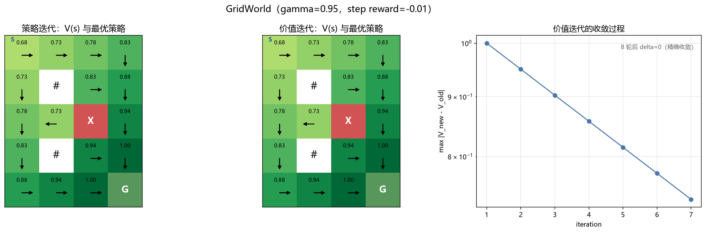

# 实验 15：GridWorld 与动态规划

脚本：`scripts/15_gridworld.py`
代码：`src/rldl/gridworld.py`
图：`docs/images/15_gridworld.png`

---

## 1. 从老虎机到 MDP

多臂老虎机没有状态：拉完一个手臂，下一步还是同样的选择。

GridWorld 加入了**状态**：你站在哪个格子，决定了能往哪走、下一步会到哪。

MDP（马尔可夫决策过程）用五个东西描述：

```text
(S, A, P, R, γ)
S：状态集合        25 个格子
A：动作集合        上/右/下/左
P：转移概率        在 s 执行 a，有多大概率到 s'
R：奖励            走一步 -0.01，到终点 +1，进陷阱 -1
γ：折扣因子        0.95，越远的奖励越不值钱
```

本次地图（5 行 × 4 列，共 20 个格子）：

```text
S . . .
. # . .
. . X .
. # . .
. . . G
```

- `S` 起点 (0,0)
- `G` 终点 (4,3)，进入得 +1，回合结束
- `X` 陷阱 (2,2)，进入得 -1，回合结束
- `#` 墙 (1,1)、(3,1)，撞墙留在原地
- 每走一步 reward = -0.01，鼓励尽快到达终点

---

## 2. 策略与价值

**策略 π(a|s)**：在每个状态选哪个动作。这里用确定性策略，一个状态对应一个箭头。

**状态价值 V(s)**：从状态 s 出发，按照策略 π 走下去，能拿到的**折扣累计奖励**的期望。

```text
Vπ(s) = E[ r_t + γ r_{t+1} + γ² r_{t+2} + ... | s_t = s ]
```

**动作价值 Q(s,a)**：在 s 先执行 a，之后按 π 走的价值。

γ 的作用：

- γ 越接近 1，越看重长远奖励；
- γ 越小，越短视，只在乎眼前。

---

## 3. 贝尔曼方程

价值函数不是猜出来的，它满足递归关系。

**贝尔曼期望方程**（评价一个固定策略）：

```text
Vπ(s) = Σ_a π(a|s) Σ_{s'} P(s'|s,a) [ R(s,a,s') + γ Vπ(s') ]
```

**贝尔曼最优方程**（找最优策略）：

```text
V*(s) = max_a Σ_{s'} P(s'|s,a) [ R(s,a,s') + γ V*(s') ]
```

一句话：**当前状态的价值 = 即时奖励 + 折扣后的下一状态价值**。

---

## 4. 策略迭代

两步交替：

**① 策略评估**：固定当前策略，反复用贝尔曼期望方程更新 V，直到收敛。

```text
V(s) ← Σ P [ R + γ V(s') ]
```

**② 策略改进**：对每个状态，算所有动作的 Q(s,a)，选最大的。

```text
π_new(s) = argmax_a Q(s,a)
```

如果新策略和旧策略一样，就收敛了；否则回到 ①。

本次运行：

```text
策略迭代：8 轮收敛
```

---

## 5. 价值迭代

不单独维护策略，直接迭代贝尔曼最优方程：

```text
V(s) ← max_a Σ P [ R + γ V(s') ]
```

收敛后，再从 V 里提取贪心策略。

本次运行：

```text
价值迭代：8 轮收敛
```

两种方法结果：

```text
最大价值差 = 0.00e+00
策略不同的状态数 = 0
```

在这个确定性小地图上，它们收敛到完全相同的答案。

---

## 6. 结果



策略（S 起点，G 终点，X 陷阱，# 墙）：

```text
 S  →  →  ↓
 ↓  #  →  ↓
 ↓  ←  X  ↓
 ↓  #  →  ↓
 →  →  →  G
```

状态价值：

```text
 0.68   0.73   0.78   0.83
 0.73   0.78   0.83   0.88
 0.78   0.73   0.00   0.94
 0.83   0.88   0.94   1.00
 0.88   0.94   1.00   0.00
```

怎么读：

- **终点和陷阱的 V = 0**：终止状态没有未来奖励，价值按定义为 0；进入它们时拿到的 +1/-1 已经算在前一个状态的 Q 里；
- **终点左边的格子 V = 1.00**：下一步进终点，拿 +1，然后结束；
- **越靠近起点，价值越低**：0.68，因为还要走好几步，每步 -0.01，而且奖励要打折；
- **陷阱左边的箭头向左**：它宁愿绕路，也不愿踏进 -1。

价值迭代的收敛曲线：

```text
delta 每轮按 γ 衰减：1.00 → 0.95 → 0.90 → ...
第 8 轮 delta 精确到 0
```

---

## 7. 为什么能精确收敛到 0

这个地图的确定性很强：从任何格子出发，最优路径最多 8 步就能到终点，且路径上没有环。价值迭代每轮把终点的奖励往回传播一格，8 轮就覆盖了所有最优路径。

如果地图里有环、或者走错会绕圈，收敛会变成渐近的，delta 会一直减小但不到 0。

---

## 8. 动态规划的局限

这一节的方法都要求**知道完整模型**：

- 转移概率 P(s'|s,a)
- 奖励函数 R(s,a,s')

现实问题里，这两个通常不知道。比如机械臂抓取，你无法提前列出「每个动作后物体移动到哪个位置」的概率。

下一节开始学**无模型方法**：

- 蒙特卡洛（MC）：跑完一整条轨迹，用实际回报估计价值；
- 时序差分（TD）：每走一步就用「即时奖励 + 下一状态估计」更新；
- SARSA / Q-learning：不学 V，直接学 Q。

它们只需要**采样**，不需要 P 和 R。

---

## 9. 自己动手

```bash
# 默认 gamma=0.95
uv run python scripts/15_gridworld.py

# 更短视：只在乎近处奖励
uv run python scripts/15_gridworld.py --gamma 0.5

# 更重视长远：起点价值会升高
uv run python scripts/15_gridworld.py --gamma 0.99

# 每步成本更高：绕路变得不可接受
uv run python scripts/15_gridworld.py --step-reward -0.1
```

观察点：

1. `--gamma 0.5` 时，起点价值变高还是变低？为什么？
2. `--gamma 0.99` 时，陷阱周围的策略有没有变化？
3. `--step-reward -0.1` 时，路径是否变得更直？
