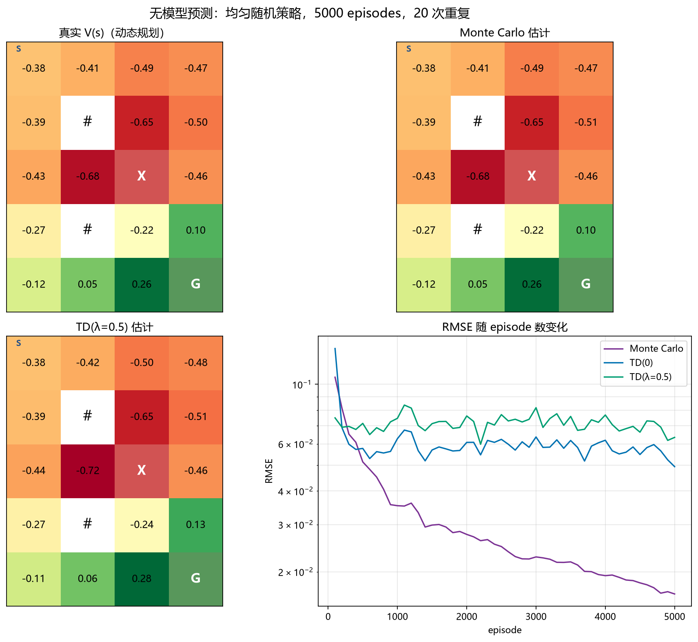

# 实验 16：无模型预测（MC / TD）

脚本：`scripts/16_mc_td.py`
代码：`src/rldl/model_free.py`
图：`docs/images/16_mc_td.png`

实验 15 的动态规划需要知道转移概率 P 和奖励 R。这一节不再使用模型，只通过和环境交互采样，估计同一个随机策略下的 V(s)。

---

## 1. 任务

- 环境：实验 15 的 GridWorld（5×4，S/G/X/#）
- 策略：均匀随机，每个状态 25% 概率选四个动作之一
- 目标：估计 V(s)，和动态规划算出的真实值比较
- 指标：RMSE = sqrt(mean((V_估计 - V_真实)²))

真实值（动态规划）：

```text
V(start) = -0.3797
```

随机策略很容易掉进陷阱，所以起点的价值是负的。

---

## 2. 蒙特卡洛（MC）

跑完一整条轨迹，从后往前算回报：

```text
G_t = r_t + γ r_{t+1} + γ² r_{t+2} + ...
```

然后更新状态价值：

```text
V(s) ← V(s) + (G_t - V(s)) / N(s)
```

本次用**首次访问 MC**：一条轨迹里同一个状态出现多次，只用第一次的回报。

特点：

- 无偏：G 是真实回报的样本；
- 方差大：一条轨迹可能撞陷阱，也可能一路到终点；
- 必须等 episode 结束才能更新；
- 只适合有终止的回合制任务。

---

## 3. TD(0)

每走一步就更新，不需要等回合结束：

```text
δ = r + γ V(s') - V(s)      # TD 误差
V(s) ← V(s) + α δ
```

`r + γV(s')` 叫 TD 目标：用下一状态的估计值代替真实回报。

特点：

- 可以在线学习，每一步都更新；
- 方差比 MC 小；
- 有偏：V(s') 本身是估计值，会引入 bootstrap 偏差；
- 常数 α 下，最终会有一个误差底线，不会精确收敛到 0。

---

## 4. TD(λ)

用资格迹把 TD 误差分配给最近访问过的状态：

```text
e(s) ← γλ e(s) + 1{s = 当前状态}
V(s) ← V(s) + α δ e(s)
```

- λ = 0：退化为 TD(0)；
- λ = 1：接近蒙特卡洛；
- 0 < λ < 1：在偏差和方差之间折中。

本次 λ = 0.5。

---

## 5. 实验设置

| 项 | 值 |
| --- | --- |
| episodes | 5000 |
| 重复次数 | 20 次取平均 |
| γ | 0.95 |
| α | 0.05 |
| λ | 0.5 |
| 每步评估 | 每 100 个 episode 算一次 RMSE |

所有算法使用**同一批轨迹**，保证比较公平。

---

## 6. 结果

| 方法 | 最终 RMSE | V(start) 估计 |
| --- | --- | --- |
| 真实值（DP） | — | -0.3797 |
| Monte Carlo | **0.0165** | -0.3804 |
| TD(0) | 0.0493 | -0.3833 |
| TD(λ=0.5) | 0.0634 | -0.3833 |



三个观察：

1. **MC 的热力图几乎和真实值重合**：5000 条完整轨迹，每个状态被访问很多次，平均回报已经足够准；
2. **TD(0) 的起点估计也很准，但整体 RMSE 更大**：访问次数少的状态误差更大；
3. **TD(λ=0.5) 这次反而最差**：资格迹把误差分摊给很多状态，常数 α 下方差更大，不是「λ 越大越好」。

---

## 7. 为什么 λ=0 反而最好

多次实验都会发现：λ=0（即 TD(0)）的 RMSE 最低，λ 越大越差。

```text
α=0.05：λ=0 → 0.0493，λ=0.5 → 0.0634，λ=0.9 → 0.1096
```

这不是 bug，λ=0 与 TD(0) 的数值完全一致。原因有三点：

1. **λ 是偏差-方差旋钮，不是「越大越准」**
   - λ=0：只用一步 TD 目标，方差最小，但有 bootstrap 偏差；
   - λ→1：更接近真实回报，偏差小，但方差大。
   在这个小表格任务里，TD(0) 的偏差本来就不大，增大 λ 只会增加方差。

2. **MC 用了样本平均，TD 用的是常数 α**
   - MC：`V += (G - V) / N`，步长 1/N 越来越小，方差会被平均掉；
   - TD(λ)：`V += α δ e`，α 固定，方差不会被平均掉；
   - λ 越大，同一个 TD 误差被分摊给越多状态，方差越大。

3. **这个任务的奖励很密集**
   每走一步都有 -0.01，TD(0) 每一步都能把信息往回传一格；不需要资格迹来跨越很长的延迟。

换成衰减 α + replacing traces 后，λ 大的方差会小一些，但 TD(0) 仍然最好：

| 设置 | λ=0 | λ=0.5 | λ=0.9 |
| --- | --- | --- | --- |
| 固定 α=0.05 | 0.0493 | 0.0634 | 0.1096 |
| 衰减 α + replacing traces | 0.0279 | 0.0293 | 0.0352 |

什么时候 λ 大才有优势：

- 奖励稀疏、延迟很长（例如只有终点给 +1 的长走廊）；
- 用函数近似 / 深度网络，需要把信用分配给很多步之前的动作；
- 这时 TD(0) 每回合只能传播一步，学得太慢，资格迹才有价值。

**结论：在这个小 GridWorld 上，TD(0) 就是最合适的。不要为了「更高级」强行调大 λ。**

## 7. 为什么 MC 最后反超 TD

看 RMSE 曲线的交叉点（约 1000 episodes）：

- **前 1000 个 episode**：TD(0) 下降更快。它每走一步都更新，信息传播得更快；
- **1000 之后**：MC 继续下降，TD(0) 停在 0.05 左右。

原因是：

- MC 用样本平均，样本越多方差越小，最终可以任意接近真实值；
- TD(0) 用常数 α 做指数加权平均，只记得最近一段时间的 target，天生有一个误差底线。把 α 逐渐减小，它也能收敛。

所以不能说「MC 一定比 TD 好」：

- 数据少、需要在线学习、回合很长 → TD 更合适；
- 回合制、可以等结束、追求无偏估计 → MC 更合适。

TD(λ) 的 λ 也是同一个权衡：λ 小偏向 TD，λ 大偏向 MC，需要配合 α 调。

---

## 8. 和动态规划的关系

三种方法都在解同一个贝尔曼方程，区别是「用什么代替未知的期望」：

| 方法 | 目标 | 需要模型？ | 需要等回合结束？ |
| --- | --- | --- | --- |
| 动态规划 | 对所有 s' 求期望 | 是 | 否 |
| 蒙特卡洛 | 真实回报 G | 否 | 是 |
| TD(0) | r + γV(s') | 否 | 否 |

TD 用「采样 + 自举（bootstrap）」把期望和真实回报都绕开了。

---

## 9. 自己动手

```bash
# 默认
uv run python scripts/16_mc_td.py

# 更少的 episode：观察 TD 前期的优势
uv run python scripts/16_mc_td.py --episodes 500

# λ=0：退化为 TD(0)
uv run python scripts/16_mc_td.py --lam 0

# λ=0.9：更接近 MC，观察方差
uv run python scripts/16_mc_td.py --lam 0.9

# 更小的 α：TD 的误差底线会更低，但收敛更慢
uv run python scripts/16_mc_td.py --alpha 0.01
```

观察点：

1. `--episodes 500` 时，MC 和 TD 谁更好？
2. `--alpha 0.01` 时，TD 的最终 RMSE 会降到多少？
3. `--lam 0.9` 的曲线是不是更抖？

---

## 10. 下一节

预测已经会了，下一节学**控制**：

- 不再评估固定策略，而是找最优策略；
- SARSA（on-policy）
- Q-learning（off-policy）
- 在 GridWorld / CliffWalking 上观察「保守」与「激进」策略的差别。
