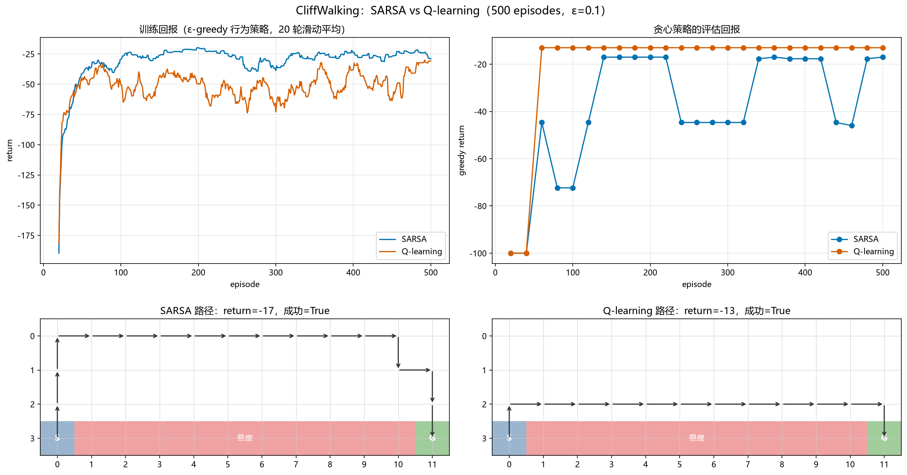

# 实验 17：SARSA vs Q-learning

脚本：`scripts/17_sarsa_qlearning.py`
代码：`src/rldl/cliffwalking.py`、`src/rldl/control.py`
图：`docs/images/17_sarsa_qlearning.png`

前面的 MC / TD 是**预测**：评估一个固定策略的价值。
这一节是**控制**：直接学 Q(s,a)，找出最优策略。

---

## 1. CliffWalking 环境

```text
S . . . . . . . . . . .
. . . . . . . . . . . .
. . . . . . . . . . . .
S C C C C C C C C C C G
```

- 起点 `(3,0)`，终点 `(3,11)`
- 悬崖 `(3,1)` ~ `(3,10)`
- 每走一步 -1
- 掉下悬崖 -100，并回到起点，回合继续
- 安全的最短路径：先上到第 2 行，向右 11 格，再下到终点，共 13 步，return = -13

---

## 2. on-policy 与 off-policy

**行为策略**：实际用来和环境交互、带 ε 探索的策略。

**目标策略**：我们想学、想评估的策略。

- **on-policy**：行为策略和目标策略是同一个；
- **off-policy**：行为策略可以 exploratory，目标策略是 greedy。

SARSA 是 on-policy，Q-learning 是 off-policy。

---

## 3. 两个更新公式

**SARSA**

```text
Q(s,a) ← Q(s,a) + α [ r + γ Q(s',a') - Q(s,a) ]
```

`a'` 是行为策略**实际选出来**的下一个动作，可能带探索。

**Q-learning**

```text
Q(s,a) ← Q(s,a) + α [ r + γ max_a' Q(s',a') - Q(s,a) ]
```

不管行为策略选了什么，目标永远假设下一步选最优动作。

区别只在这一项：

```text
SARSA：      Q(s', a')       ← 实际动作
Q-learning： max Q(s', ·)    ← 最优动作
```

---

## 4. 实验设置

| 项 | 值 |
| --- | --- |
| episodes | 500 |
| 重复次数 | 3 个种子取平均 |
| α | 0.5 |
| γ | 1.0 |
| ε | 0.1 |
| 评估 | 每 20 个 episode 跑一次贪心策略 |

---

## 5. 结果

| 算法 | 贪心策略 return | 成功率 | 训练中掉崖次数 |
| --- | --- | --- | --- |
| SARSA | -17 | 100% | **45** |
| Q-learning | **-13** | 100% | 174 |



三个现象：

1. **训练回报**：SARSA 更高（更接近 0）。它把 ε 探索可能带来的掉崖风险算进了 Q 值，学会了绕远一点的安全路；
2. **贪心评估回报**：Q-learning 更好（-13 vs -17）。关掉探索后，它走的是最短安全路径；
3. **训练中的掉崖次数**：Q-learning 是 SARSA 的近 4 倍。它一直在「贴着悬崖」的最优路径上探索，ε 随机一步就掉下去。

---

## 6. 两条路径

**SARSA**

```text
(3,0) → 上到第 0 行 → 向右 10 格 → 下到第 1 行 → 向右 → 下到终点
共 17 步，离悬崖两行远
```

**Q-learning**

```text
(3,0) → 上到第 2 行 → 向右 11 格 → 下到终点
共 13 步，紧贴悬崖上面一行
```

Q-learning 学到的确实是**最优路径**，但它在训练时更常掉崖。

---

## 7. 为什么会这样

SARSA 更新时用的是 `Q(s', a')`，而 `a'` 来自 ε-greedy：

- 在悬崖边，ε=0.1 意味着有 10% 概率随机走一步，可能直接掉下去；
- 这个风险会被算进 `Q(s,a)`，所以 SARSA 觉得悬崖边的状态「没那么好」；
- 它于是选择更安全的第 0 行。

Q-learning 更新时用的是 `max Q(s', ·)`：

- 它假设下一步一定选最优动作，不考虑 ε 探索；
- 所以悬崖边的状态在它眼里仍然是好状态；
- 它学到了最优路径，但训练时行为策略经常掉崖。

一句话：

```text
SARSA 学的是「带探索的当前策略」的价值；
Q-learning 学的是「完全贪心的最优策略」的价值。
```

---

## 8. 什么时候用哪个

- 训练中不能承担风险（真机、机器人）→ SARSA 或更保守的 on-policy；
- 可以安全试错、只关心最终策略 → Q-learning；
- ε 越小，两者越接近；ε 越大，SARSA 越保守；
- Q-learning 是 DQN 的基础，后面深度强化学习会继续用它。

---

## 9. 自己动手

```bash
# 默认
uv run python scripts/17_sarsa_qlearning.py

# 更少探索：两者策略会接近
uv run python scripts/17_sarsa_qlearning.py --epsilon 0.01

# 更多探索：SARSA 会更保守
uv run python scripts/17_sarsa_qlearning.py --epsilon 0.3

# 更多 episode：观察 Q-learning 是否稳定到 -13
uv run python scripts/17_sarsa_qlearning.py --episodes 1500
```

观察点：

1. `--epsilon 0.01` 时，SARSA 的路径会不会也贴到悬崖边？
2. `--epsilon 0.3` 时，两条路径的差距会不会更大？
3. 训练回报和贪心评估回报，为什么排序相反？

---

## 10. 下一节

阶段 3 还剩一个概念：**重要性采样（importance sampling）**。

Q-learning 已经是 off-policy，但它用的是 max，不需要重要性采样。
当我们要用行为策略采样的数据去估计**另一个策略**的期望时，就需要重要性采样来修正分布差异。

之后进入阶段 4：DQN、REINFORCE、PPO。
