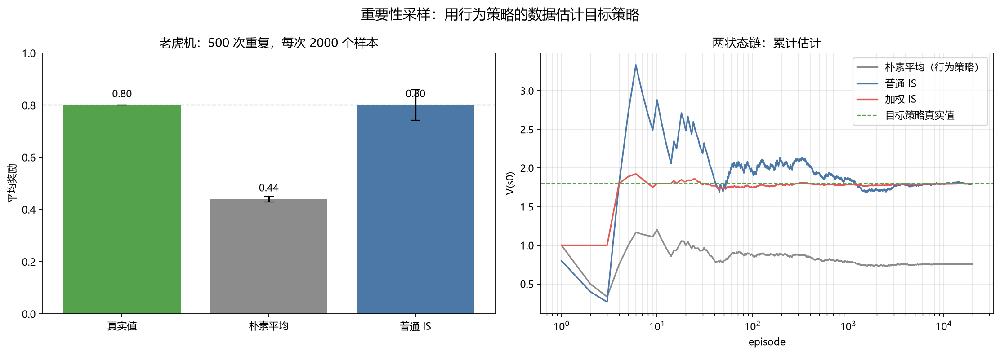

# 实验 18：重要性采样

脚本：`scripts/18_importance_sampling.py`
代码：`src/rldl/importance.py`
图：`docs/images/18_importance_sampling.png`

---

## 1. 问题

我们有一个**行为策略** b，用它和环境交互、收集数据。
但我们想评估另一个**目标策略** π。

直接用行为策略的数据求平均，得到的是 b 的价值，不是 π 的。

重要性采样（importance sampling, IS）用权重修正分布差异：

```text
E_π[X] = E_b[ ρ × X ]

ρ = π(a|s) / b(a|s)
```

- 如果 π 选这个动作的概率比 b 大，ρ > 1，这个样本被放大；
- 如果 π 根本不会选这个动作，ρ = 0，这个样本被丢弃。

前提：**只要 π(a|s) > 0，就必须有 b(a|s) > 0**，否则分母为 0，无法修正。

---

## 2. 老虎机例子

- 10 个手臂，最佳 arm 4，中奖概率 0.80；
- 行为策略：均匀随机，每个手臂 10%；
- 目标策略：永远拉 arm 4。

| 方法 | 估计值 |
| --- | --- |
| 真实值 | 0.800 |
| 朴素平均 | 0.439（这是行为策略的平均） |
| 普通 IS | 0.800 ± 0.058 |

朴素平均把 10 个手臂混在一起，得到 0.44；IS 给 arm 4 的样本乘 10，其余乘 0，正好还原目标策略。

误差棒 ±0.058 说明 IS 的方差很大：大部分样本权重是 0，只有约 10% 的样本真正参与估计。

---

## 3. 两状态链：轨迹级 IS

```text
state 0 --forward(+1)--> state 1 --forward(+1)--> terminal
         \--quit(0)--> terminal          \--quit(0)--> terminal
```

- 行为策略：每个状态 50% forward，50% quit；
- 目标策略：state 0 一定 forward，state 1 以 0.8 概率 forward；
- γ = 1。

真实目标价值：

```text
V(1) = 0.8 × 1 = 0.8
V(0) = 1 + V(1) = 1.8
```

轨迹的重要性权重是每一步比值的**乘积**：

```text
state 0：π(forward)/b(forward) = 1.0 / 0.5 = 2
state 1：π(forward)/b(forward) = 0.8 / 0.5 = 1.6
         π(quit)   /b(quit)    = 0.2 / 0.5 = 0.4

两次都 forward：ρ = 2 × 1.6 = 3.2
```

结果：

| 方法 | 估计值 |
| --- | --- |
| 目标策略真实值 | 1.800 |
| 朴素平均 | 0.752（行为策略的价值） |
| 普通 IS | 1.795 |
| 加权 IS | 1.796 |



右图是逐 episode 的累计曲线：

- **朴素平均**收敛到 0.75，稳定但估计的是错的策略；
- **普通 IS** 前期剧烈震荡，后期才慢慢收敛到 1.8；
- **加权 IS** 用 `ΣρG / Σρ` 归一化，方差小得多，曲线平滑。

---

## 4. 两种 IS 估计

**普通重要性采样**

```text
V = (1/N) Σ ρ_i G_i
```

- 无偏；
- 方差大，尤其是轨迹很长时，ρ 的乘积可能非常大。

**加权重要性采样**

```text
V = Σ ρ_i G_i / Σ ρ_i
```

- 方差小；
- 有限样本有偏，但通常更实用。

实践中还常用**逐步 IS**（per-decision IS）：每一步单独乘一个比值，而不是整条轨迹乘一个总乘积，可以降低方差。

---

## 5. Q-learning 为什么不需要 IS

Q-learning 的更新目标：

```text
r + γ max_a' Q(s', a')
```

它直接对 Q 取 max，学习的是贪心目标策略，和行为策略选了什么动作无关。
所以 Q-learning 是 off-policy，但**不需要重要性采样**。

需要 IS 的是：

- off-policy 蒙特卡洛评估：用 b 的轨迹估计 π 的价值；
- 某些 off-policy 策略梯度方法；
- 用旧策略数据训练新策略（如 PPO 的 ratio）。

---

## 6. 重要性采样的坑

1. **覆盖要求**：π 会选的动作，b 必须以正概率选到；
2. **方差随轨迹长度指数增长**：ρ 是连乘，10 步、100 步会非常不稳；
3. **有效样本量很小**：大部分权重接近 0，真正起作用的样本很少；
4. **加权 IS 有偏**：虽然方差小，但不要把它当成无偏估计。

---

## 7. 自己动手

```bash
# 默认
uv run python scripts/18_importance_sampling.py

# 行为策略更偏，IS 方差更大
uv run python scripts/18_importance_sampling.py --samples 500

# 更多 episode，观察普通 IS 慢慢收敛
uv run python scripts/18_importance_sampling.py --episodes 100000
```

观察点：

1. 行为策略从均匀改成 90% 拉 arm 0，IS 还能估计 arm 4 吗？
2. 链变长（比如 5 个状态），普通 IS 的方差会怎样？
3. 加权 IS 在多少 episode 后稳定到 1.8？

---

## 8. 阶段 3 完成

```text
多臂老虎机（ε-greedy / UCB / Thompson）  ✓
MDP、贝尔曼、策略迭代 / 价值迭代          ✓
无模型预测（MC / TD / TDλ）               ✓
无模型控制（SARSA / Q-learning）          ✓
重要性采样与 off-policy                   ✓
```

下一阶段进入深度强化学习：

- DQN + target network + replay buffer（CartPole）
- Double DQN / Dueling DQN
- REINFORCE + baseline
- Actor-Critic / PPO
