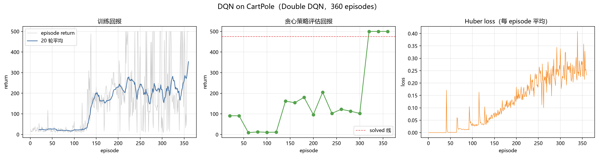

# 实验 19：DQN 解决 CartPole

脚本：`scripts/19_dqn_cartpole.py`
代码：`src/rldl/dqn.py`
图：`docs/images/19_dqn_cartpole.png`

---

## 1. CartPole 环境

| 项 | 值 |
| --- | --- |
| 状态 | 4 维：小车位置、速度、杆角度、角速度 |
| 动作 | 2 个：向左推、向右推 |
| 奖励 | 每坚持一步 +1 |
| 终止 | 杆倾斜超过 12° 或小车出界 |
| 最大步数 | 500 |
| 目标 | 平均回报 ≥ 475（连续 3 次评估） |

---

## 2. DQN 的四个部件

**① Q 网络**

```text
4 维状态 → 128 → 128 → 2 个 Q 值
```

**② 经验回放（replay buffer）**

把 `(s, a, r, s', done)` 存进固定容量的环形缓冲区，训练时随机抽 64 条。

- 打破连续样本之间的相关性；
- 一条经验可以被多次使用。

**③ 目标网络（target network）**

单独复制一份 Q 网络，参数冻结，每 500 步从在线网络同步一次。

如果直接用在线网络算 TD 目标，目标会跟着参数一起变，训练容易追逐自己、发散。

**④ ε-greedy**

从 1.0 线性衰减到 0.05，前 5000 步逐渐从探索转向利用。

---

## 3. 更新公式

TD 目标：

```text
y = r + γ max_a' Q_target(s', a')
```

损失：

```text
L = Huber( Q_online(s,a), y )
```

Huber 比 MSE 更抗离群值，梯度更稳。

---

## 4. Double DQN 的区别

普通 DQN：

```text
y = r + γ max_a' Q_target(s', a')
```

`max` 会把估计误差也放大，导致 Q 值被高估。

Double DQN：

```text
a* = argmax_a Q_online(s', a)     ← 用在线网络选动作
y  = r + γ Q_target(s', a*)       ← 用目标网络评估
```

把「选动作」和「评估动作」分开，减少高估。

本次脚本默认使用 Double DQN；`--no-double` 可以切回普通 DQN。

---

## 5. 实验设置

| 项 | 值 |
| --- | --- |
| episodes 上限 | 500 |
| batch | 64 |
| γ | 0.99 |
| lr | 1e-3 |
| buffer | 50000 |
| warmup | 1000 步 |
| target 同步 | 每 500 步 |
| ε | 1.0 → 0.05，5000 步 |
| 评估 | 每 20 个 episode，贪心跑 3 局 |
| 设备 | **CPU**（网络很小，CPU 比 GPU 快） |

---

## 6. 结果

**Double DQN（默认）：**

```text
episode 320 | eval=500.0
episode 340 | eval=500.0
episode 360 | eval=500.0
连续 3 次评估达到 475，提前停止
best eval return = 500.0
CPU 总耗时约 2 分 43 秒
```

**普通 DQN（--no-double，400 episodes）：**

```text
最好一次 eval=469.7（episode 360）
之后掉到 ~100，训练回报也剧烈波动
没有稳定达到 475
```



三个现象：

1. **训练回报很抖**：ε=0.05 时仍有随机动作，短回合会拉低平均；
2. **评估回报是阶梯式上升**：从 ~100 突然跳到 500，DQN 的「顿悟」现象；
3. **loss 不下降反升**：Q 值范围变大，Huber loss 自然上升，不代表训练变差。看评估回报，不要只看 loss。

---

## 7. 为什么评估比训练稳

训练时：

- ε=0.05，每 20 步有一次随机动作；
- 随机动作可能直接把杆推倒，回报骤降。

评估时：

- 纯贪心，不探索；
- 跑 3 局取平均，仍然有波动，但能看到真实策略水平。

所以训练回报低不等于策略差。

---

## 8. 常见坑

1. **把 `truncated` 当成真正终止**：CartPole 500 步截断时，理论上应该 bootstrap，而不是把 `done=1`；这里为了简单按终止处理，影响不大。
2. **目标网络同步太频繁**：等于没有目标网络，容易发散。
3. **buffer 太小 / warmup 太短**：样本相关性太强。
4. **只看 loss**：DQN 的 loss 不是单调下降的。
5. **用 GPU 跑小网络**：每次操作都有 kernel 启动开销，反而比 CPU 慢。

---

## 9. 自己动手

```bash
# 默认：Double DQN，CPU
uv run python scripts/19_dqn_cartpole.py

# 普通 DQN 对比
uv run python scripts/19_dqn_cartpole.py --no-double

# 更慢的探索：可能更稳，但需要更多 episode
uv run python scripts/19_dqn_cartpole.py --eps-decay 10000

# 更频繁地同步目标网络
uv run python scripts/19_dqn_cartpole.py --target-update 200

# 用 GPU（不一定更快）
uv run python scripts/19_dqn_cartpole.py --device cuda
```

观察点：

1. `--no-double` 时，Q 值是否更容易高估？评估回报是否更不稳？
2. `--eps-decay 10000` 需要多少 episode 才能到 475？
3. `--target-update 200` 和 1000 哪个更稳？

---

## 10. 下一节

- Dueling DQN：把 Q 拆成 V(s) + A(s,a)，提高样本效率；
- 与 Double DQN 组合，做消融对比；
- 然后进入策略梯度：REINFORCE、Actor-Critic、PPO。
