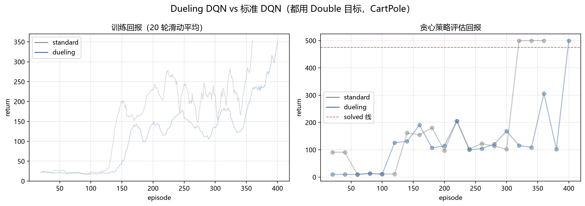

# 实验 20：Dueling DQN vs 标准 DQN

脚本：`scripts/20_dueling_dqn.py`
图：`docs/images/20_dueling_dqn.png`

---

## 1. 想法

标准 DQN 直接输出每个动作的 Q 值。

Dueling DQN 把 Q 拆成两部分：

```text
Q(s,a) = V(s) + A(s,a)
```

- **V(s)**：这个状态本身有多好，和选什么动作无关；
- **A(s,a)**：选这个动作比平均水平好多少（advantage）。

很多状态下，选哪个动作差别不大。这时只学 V(s) 就够了，A 只需要学「相对差异」，样本效率更高。

---

## 2. 为什么要减去均值

如果直接 `Q = V + A`，分解不唯一：

```text
V + A = (V + c) + (A - c)
```

给 V 加常数、给 A 减同样的常数，Q 不变。网络无法确定该学哪个。

所以强制让 A 的均值为 0：

```text
Q(s,a) = V(s) + A(s,a) - mean_a A(s,a)
```

这样 V(s) 就是所有动作 Q 值的平均，A 只负责相对优势。

---

## 3. 网络结构

两个网络都用相同的共享特征层：

```text
标准：
  4 → 128 → ReLU → 128 → ReLU → 2 个 Q 值

Dueling：
  4 → 128 → ReLU → 128 → ReLU
          ├── V head: 128 → 1
          └── A head: 128 → 2
  Q = V + A - mean(A)
```

参数量几乎一样（约 1.74 万），差别只在输出层的组织方式。

---

## 4. 实验设置

为了只比较网络结构，两个实验完全相同：

| 项 | 值 |
| --- | --- |
| 环境 | CartPole-v1 |
| 目标 | Double DQN（两者都用） |
| episodes 上限 | 400 |
| batch / γ / lr | 64 / 0.99 / 1e-3 |
| ε | 1.0 → 0.05，5000 步 |
| 目标网络同步 | 每 500 步 |
| 随机种子 | 1 个 |
| 设备 | CPU |

---

## 5. 结果

| 结构 | 最好 eval | 首次达到 475 | 实际 episode |
| --- | --- | --- | --- |
| 标准 DQN | 500.0 | **320** | 360（连续 3 次达标） |
| Dueling DQN | 500.0 | 400 | 400（最后一次才达标） |



- 标准 DQN 在 episode 320 附近突然跳到 500，并稳定；
- Dueling DQN 大部分时间在 100~200 徘徊，直到 episode 400 才第一次到 500；
- 训练回报也是标准 DQN 更早上升。

**在这个任务上，Dueling 没有优势，反而更慢。**

---

## 6. 怎么解释这个负面结果

CartPole 只有 **2 个动作**，而且两个动作都很有意义（左推/右推），几乎不存在「动作无关紧要」的状态。

Dueling 的优势场景是：

- 动作很多（比如 Atari 的 18 个按键）；
- 很多动作在大多数状态下没有区别；
- 需要把「状态好坏」和「动作差异」分开学习。

CartPole 不满足这些条件，所以 Dueling 的额外结构没有带来收益，反而增加了优化难度。

另外，这次只跑了 **1 个种子**，DQN 本身方差很大。更严谨的结论需要 3~5 个种子：

```bash
uv run python scripts/20_dueling_dqn.py --seeds 3
```

不能因为一次实验就下结论「Dueling 没用」。它在 Atari 上的原始论文里确实更强。

---

## 7. 自己动手

```bash
# 默认：两个结构各跑 1 个种子
uv run python scripts/20_dueling_dqn.py

# 只跑 Dueling
uv run python scripts/20_dueling_dqn.py --archs dueling

# 多种子，看均值
uv run python scripts/20_dueling_dqn.py --seeds 3

# 给 Dueling 更多 episode
uv run python scripts/20_dueling_dqn.py --archs dueling --episodes 600
```

观察点：

1. Dueling 的 V 和 A 数值范围大概是多少？
2. 多种子下，两者谁先达到 475 更稳定？
3. 如果把动作增加到 10 个（其中很多是无效动作），Dueling 会不会更有优势？

---

## 8. 下一节

DQN 系列告一段落，接下来进入**策略梯度**：

- REINFORCE：直接对策略求梯度；
- baseline：降低方差；
- Actor-Critic；
- PPO。

和 DQN 的区别：DQN 学 Q 值再间接得到策略；策略梯度直接参数化 π(a|s)。
