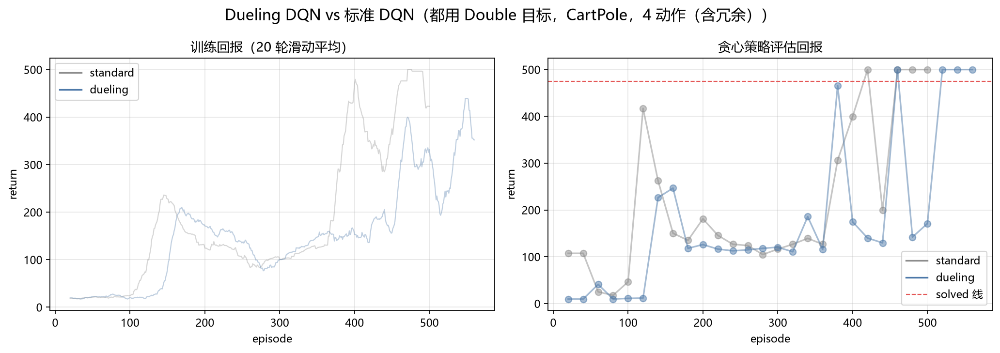

# 实验 21：冗余动作版 CartPole

脚本：`scripts/20_dueling_dqn.py --redundant-actions 4`
代码：`src/rldl/redundant_cartpole.py`
图：`docs/images/21_redundant_dueling.png`

---

## 1. 为什么做这个实验

实验 20 在普通 CartPole（2 个动作）上，Dueling 没有超过标准 DQN。

我们猜测原因是「动作太少、没有冗余」。于是把动作空间扩展成 4 个：

```text
动作 0 → 左推
动作 1 → 右推
动作 2 → 左推（重复）
动作 3 → 右推（重复）
```

这样多个动作的 Q 值完全相同，理论上更适合 Dueling 的 V/A 分解：

```text
Q(s, 左推1) = Q(s, 左推2)
Q(s, 右推1) = Q(s, 右推2)
```

注意：均匀随机探索仍然以 50% 概率选到左、50% 选到右，探索能力没有被稀释。

---

## 2. 实验 A：lr=1e-3，400 episodes

| 结构 | 最好 eval | 首次达标 |
| --- | --- | --- |
| 标准 DQN | 373.3 | 未达标 |
| Dueling DQN | 178.0 | 未达标 |

加入冗余动作后，两个都学不动了；Dueling 反而更差。

---

## 3. 实验 B：lr=5e-4，600 episodes

降低学习率后，两者都能学会：

| 结构 | 最好 eval | 首次达到 475 | 实际 episode |
| --- | --- | --- | --- |
| 标准 DQN | 500 | **420** | 500 |
| Dueling DQN | 500 | 460 | 560 |



标准 DQN 仍然比 Dueling 早 40 个 episode 达标。

---

## 4. 结论：冗余动作也没有解锁 Dueling 的优势

这个实验说明：

- **仅仅增加重复动作，不足以让 Dueling 占优**；
- 标准 DQN 的共享特征层本身就能学会「重复动作 Q 值相同」；
- Dueling 的优势更多体现在**大规模动作空间 + 图像输入 + 样本效率**上，而不是小 MLP 的 CartPole。

可能的原因：

1. CartPole 的状态只有 4 维，V(s) 很容易学，A(s,a) 的分解没有带来额外信息；
2. 左/右两个动作仍然都必须精确使用，不存在「大量动作无关紧要」的情况；
3. 只跑了 1 个种子，DQN 方差很大；
4. Dueling 可能需要单独的 lr / 初始化 / 更多 episode，本次没有逐架构调参。

---

## 5. 要真正复现 Dueling 的优势

需要更接近论文的设置：

- Atari（18 个动作，图像输入，CNN 特征）；
- 多种子（3~5 个）取均值；
- 每个架构单独调 lr、target update、ε 衰减；
- 比较样本效率（达到某分数所需的环境步数），而不只是最终分数。

这些实验成本高，不适合在当前学习项目里展开。**负面结果本身也是有价值的：架构改进不是无条件生效的。**

---

## 6. 复现

```bash
# 冗余动作，默认参数
uv run python scripts/20_dueling_dqn.py --redundant-actions 4 --out outputs/21_redundant_dueling

# 低学习率，跑满 600 episode
uv run python scripts/20_dueling_dqn.py --redundant-actions 4 --lr 5e-4 --episodes 600

# 普通 2 动作版本
uv run python scripts/20_dueling_dqn.py
```

---

## 7. 下一步

DQN 系列到此结束，进入策略梯度：

- REINFORCE：直接对策略 π(a|s) 求梯度；
- baseline：降低方差；
- Actor-Critic；
- PPO。
