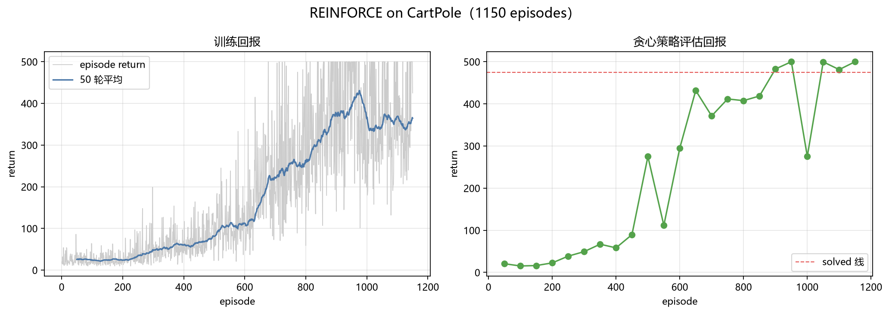

# 实验 22：REINFORCE 解决 CartPole

脚本：`scripts/22_reinforce_cartpole.py`
代码：`src/rldl/policy_gradient.py`
图：`docs/images/22_reinforce_cartpole.png`

---

## 1. 和 DQN 的区别

DQN：

```text
学 Q(s,a) → 用 argmax 得到策略
```

REINFORCE：

```text
直接参数化 π(a|s) → 用回报的梯度更新策略
```

策略网络输出动作概率，不再需要 Q 值和 max。

---

## 2. 策略梯度

目标：最大化期望回报 J(θ)。

策略梯度定理：

```text
∇J(θ) = E[ ∇ log π(a|s) × G_t ]
```

直觉：

- 如果某个动作之后的回报 G_t 很高，就提高这个动作的概率；
- 如果回报很低，就降低它的概率。

实际损失：

```text
loss = -mean( log π(a_t|s_t) × advantage_t )
```

`advantage_t` 越大，这个动作被提高得越多。

---

## 3. baseline

直接用 G_t 的方差很大：同一条轨迹的回报可能从 10 到 500。

引入状态价值 V(s) 作为 baseline：

```text
advantage_t = G_t - V(s_t)
```

- V(s) 是「这个状态平均能拿多少」；
- G_t - V(s) 是「这次比平均好多少」。

baseline 不改变梯度的期望，但能显著降低方差。

本次用一个单独的 `ValueNetwork` 学 V(s)，和策略网络一起训练。

---

## 4. 熵奖励

如果策略过早变成「永远选同一个动作」，就会塌缩。

熵衡量策略的随机性：

```text
loss = 策略损失 - entropy_coef × 熵
```

减去熵等于鼓励保持多样性。

但本次实验里 `entropy_coef=0.01` 太强，策略一直保持均匀、学不动；最后用 **0** 才成功。

---

## 5. 第一次失败

最初版本：

```text
无 baseline，回报标准化，lr=1e-3，1500 episodes
```

结果策略塌缩：

```text
return ≈ 10，entropy ≈ 0.01
```

它学会了「永远选一个动作」，但这个动作只能撑 10 步。

教训：

- 单回合 REINFORCE 方差很大；
- 没有 baseline 时，策略容易锁死在坏动作；
- 熵奖励太强又会阻止策略收敛。

---

## 6. 最终配置

| 项 | 值 |
| --- | --- |
| baseline | 有（ValueNetwork） |
| 回报标准化 | 关 |
| 熵系数 | 0 |
| lr | 3e-4 |
| γ | 0.99 |
| episodes 上限 | 1500 |
| 评估 | 每 50 个 episode，贪心跑 3 局 |
| 设备 | CPU |

---

## 7. 结果

```text
episode  900 | eval=482.7
episode 1050 | eval=499.7
episode 1100 | eval=481.3
episode 1150 | eval=500.0
连续 3 次评估达到 475，提前停止
best eval return = 500.0
CPU 总耗时约 3 分 43 秒
```



三个现象：

1. **前期很慢**：前 300 个 episode 回报只有 20~50；
2. **训练回报抖动很大**：REINFORCE 用整条轨迹的回报，方差天然大；
3. **评估阶梯式上升**：从 episode 600 开始加速，1150 稳定到 500。

---

## 8. 和 DQN 的对比

| | DQN / Double DQN | REINFORCE + baseline |
| --- | --- | --- |
| 学到的东西 | Q(s,a) | π(a|s) + V(s) |
| 数据 | 可重复使用 replay buffer | 必须用当前策略新采的数据 |
| 样本效率 | 高 | 低 |
| 方差 | 中 | 高 |
| 达到 475 | ~320 episodes | ~1150 episodes |
| 实现复杂度 | 较高 | 较低 |

REINFORCE 更简单，但更慢、更不稳。它的价值是引出后面的 Actor-Critic 和 PPO。

---

## 9. 常见坑

1. **没有 baseline**：策略容易塌缩；
2. **回报不标准化**：梯度尺度随回合长度剧烈变化；
3. **熵系数太大**：策略一直均匀，学不动；
4. **学习率太大**：一次更新把策略推死；
5. **用旧策略的数据**：REINFORCE 是 on-policy，数据必须来自当前策略。

---

## 10. 自己动手

```bash
# 默认：带 baseline，能解 CartPole
uv run python scripts/22_reinforce_cartpole.py

# 关掉 baseline：观察策略塌缩
uv run python scripts/22_reinforce_cartpole.py --no-baseline --episodes 1200

# 打开回报标准化
uv run python scripts/22_reinforce_cartpole.py --normalize

# 加一点熵奖励
uv run python scripts/22_reinforce_cartpole.py --entropy-coef 0.001
```

观察点：

1. `--no-baseline` 时，entropy 会不会迅速降到 0？
2. `--normalize` 对收敛速度有没有帮助？
3. `--entropy-coef 0.001` 时，策略会不会更慢但更稳？

---

## 11. 下一节

REINFORCE 的方差问题，靠 **Actor-Critic** 解决：

- Critic 学 V(s)，用 TD 误差代替整条回报；
- Actor 用 `δ = r + γV(s') - V(s)` 更新策略；
- 不需要等回合结束，方差更小。

之后是 PPO：用重要性采样和裁剪，把 on-policy 训练做得更稳定。
