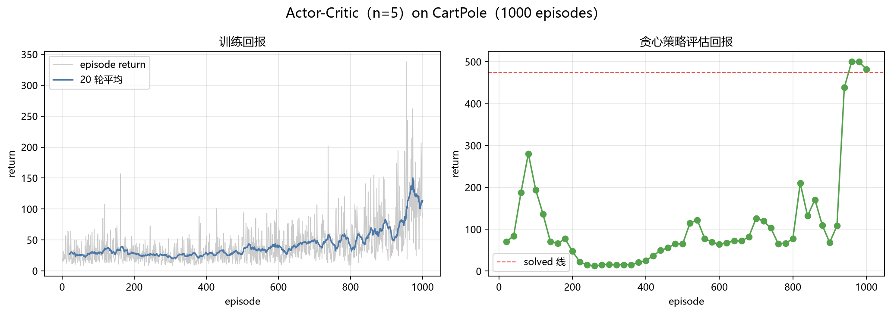

# 实验 23：Actor-Critic（A2C）解决 CartPole

脚本：`scripts/23_actor_critic_cartpole.py`
代码：`src/rldl/policy_gradient.py`（新增 `n_step_returns`）
图：`docs/images/23_actor_critic_cartpole.png`

---

## 1. 和 REINFORCE 的区别

REINFORCE：

```text
跑完整条轨迹 → 用完整回报 G_t 更新策略
```

A2C：

```text
Critic 学 V(s)
Actor 用 n 步回报减去 V(s) 的 advantage 更新
```

不再等整条轨迹结束，方差更小。

---

## 2. n 步回报

```text
G_t^(n) = r_t + γ r_{t+1} + ... + γ^(n-1) r_{t+n-1} + γ^n V(s_{t+n})
```

- 前 n 步用真实奖励；
- 后面用 Critic 的 V(s) 自举（bootstrap）；
- 如果窗口内遇到终止，就不再加 bootstrap。

本次 n=5。

---

## 3. 两个损失

**Actor**

```text
advantage = G_t^(n) - V(s_t)
policy_loss = -mean( log π(a_t|s_t) × advantage )
```

**Critic**

```text
value_loss = MSE( V(s_t), G_t^(n) )
```

总损失：

```text
loss = policy_loss + 0.5 × value_loss - 0.01 × 熵
```

熵奖励防止策略过早塌缩。

---

## 4. 一个关键的调参坑

最初版本对 advantage 做了标准化：

```text
advantage = (advantage - mean) / std
```

结果策略一直保持均匀：

```text
entropy ≈ 0.693（二动作的最大熵）
eval ≈ 10~30
actor 梯度 ≈ 1e-8
```

原因：策略接近均匀时，`log π(a|s)` 对两个动作几乎相同，标准化后的 advantage 均值为 0，乘积在 batch 内大量抵消，梯度小到几乎不更新。

改成**不标准化 advantage**、直接用 `G - V` 后，策略开始学习。

这不是说「标准化永远错」，而是：**缩放方式要配合网络、学习率和 batch**。在本次设置里，原始 advantage 更有效。

---

## 5. 实验设置

| 项 | 值 |
| --- | --- |
| n 步 | 5 |
| 每次更新收集 | 4 个 episode |
| lr | 1e-3（actor / critic 各自 Adam） |
| γ | 0.99 |
| 熵系数 | 0.01 |
| episodes 上限 | 1200 |
| 评估 | 每 20 个 episode，贪心跑 3 局 |
| 设备 | CPU |

---

## 6. 结果

```text
episode  940 | eval=438.3
episode  960 | eval=500.0
episode  980 | eval=500.0
episode 1000 | eval=482.0
连续 3 次评估达到 475，提前停止
best eval return = 500.0
CPU 总耗时约 60 秒
```



现象：

- 训练回报长期只有 30~100，因为行为策略仍在随机探索；
- 贪心评估从 episode 900 后突然上升到 500；
- 训练回报低不代表策略差，**评估看贪心策略**；
- critic loss 很大（几十），因为回报范围大；不要用 loss 判断效果。

---

## 7. 和 REINFORCE 对比

| | REINFORCE + baseline | A2C（n=5） |
| --- | --- | --- |
| 更新信号 | 完整回报 G_t | n 步回报 + bootstrap |
| 达到 475 | ~1150 episodes | ~1000 episodes |
| CPU 耗时 | 3 分 43 秒 | 约 1 分钟 |
| 方差 | 高 | 较低 |
| 实现复杂度 | 低 | 中 |

A2C 收敛略快、耗时更短，但 CartPole 上两者的差距不算大。

---

## 8. 常见坑

1. **advantage 缩放**：标准化可能让梯度消失，要配合 lr/batch 调；
2. **n 步选择**：n 太小偏差大，n 太大方差大，常用 5~20；
3. **截断处理**：CartPole 500 步截断时理论上要 bootstrap，本次简化处理；
4. **critic loss 很大**：回报范围大时正常，不代表训练失败；
5. **熵系数**：太大策略不收敛，太小会塌缩。

---

## 9. 自己动手

```bash
# 默认：n=5
uv run python scripts/23_actor_critic_cartpole.py

# 单步 TD
uv run python scripts/23_actor_critic_cartpole.py --n-step 1

# 更长的 n 步
uv run python scripts/23_actor_critic_cartpole.py --n-step 10

# 不加熵奖励
uv run python scripts/23_actor_critic_cartpole.py --entropy-coef 0
```

观察点：

1. n=1 和 n=10 哪个收敛更快？
2. `--entropy-coef 0` 时策略会不会塌缩？
3. 把 batch-episodes 从 4 改到 1，曲线会怎样？

---

## 10. 下一节

**PPO**：在 A2C 基础上加：

- 重要性采样 ratio；
- 裁剪目标（clip）；
- 多次复用同一批数据；
- GAE 优势估计。

PPO 是目前最常用的策略梯度算法之一。
