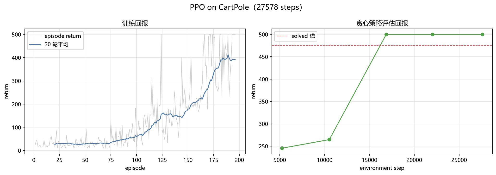

# 实验 24：PPO 解决 CartPole

脚本：`scripts/24_ppo_cartpole.py`
代码：`src/rldl/ppo.py`（GAE）
图：`docs/images/24_ppo_cartpole.png`

---

## 1. PPO 在 A2C 上加了什么

A2C：

```text
用一批数据更新一次，更新完就丢掉
```

PPO：

```text
1. 收集一批完整 episode
2. 用 GAE 算优势
3. 对同一批数据做多轮 minibatch 更新
4. 用 ratio 裁剪，限制每次策略变化的幅度
```

这样样本利用率更高，同时训练更稳。

---

## 2. 重要性采样 ratio

用旧策略采的数据，评估新策略：

```text
r_t(θ) = π_θ(a_t|s_t) / π_old(a_t|s_t)
```

如果新旧策略差不多，r ≈ 1；变化太大，r 会远离 1。

PPO 的裁剪目标：

```text
L_clip = min( r_t A_t, clip(r_t, 1-ε, 1+ε) A_t )
```

- A_t > 0（好动作）：ratio 最多放大到 1+ε；
- A_t < 0（坏动作）：ratio 最多缩小到 1-ε；
- 超出范围的部分不再给梯度。

目的：**每次更新别把策略推得太远**，避免一次坏更新毁掉训练。

---

## 3. GAE

```text
δ_t = r_t + γ V(s_{t+1}) - V(s_t)
A_t = δ_t + γλ δ_{t+1} + (γλ)² δ_{t+2} + ...
```

- λ=0：退化成一步 TD 误差（偏差大、方差小）；
- λ=1：接近蒙特卡洛回报（偏差小、方差大）；
- 常用 λ=0.95。

GAE 是 PPO 里比 REINFORCE/A2C 更平滑的优势估计。

---

## 4. 总损失

```text
policy_loss = -mean( min(ratio*A, clip(ratio)*A) )
value_loss  = MSE( V(s), returns )
entropy     = 策略熵

loss = policy_loss + 0.5 * value_loss - 0.01 * entropy
```

---

## 5. 实验设置

| 项 | 值 |
| --- | --- |
| rollout | 1024 步（完整 episode） |
| update epochs | 10 |
| minibatch | 64 |
| γ / λ | 0.99 / 0.95 |
| clip ε | 0.2 |
| lr | 3e-4 |
| entropy | 0.01 |
| 总步数上限 | 80000 |
| 评估 | 每 5000 步，贪心跑 3 局 |
| 设备 | CPU |

---

## 6. 结果

```text
step   5231 | train_return(20)= 96.8  | eval=245.3
step  10523 | train_return(20)=153.3  | eval=264.7
step  16872 | train_return(20)=276.9  | eval=500.0
step  22034 | train_return(20)=389.4  | eval=500.0
step  27578 | train_return(20)=392.9  | eval=500.0
连续 3 次评估达到 475，提前停止
best eval return = 500.0
CPU 总耗时约 36 秒
```



- 训练回报平稳上升，没有 REINFORCE 那种大起大落；
- 评估从 264 直接跳到 500，之后保持；
- 27578 步达标，比 A2C / REINFORCE 用的环境步数更少。

---

## 7. 四种策略梯度对比

| 算法 | 达到 475 | 耗时 | 特点 |
| --- | --- | --- | --- |
| REINFORCE + baseline | ~1150 episodes | 3 分 43 秒 | 简单、方差大 |
| A2C（n=5） | ~1000 episodes | 约 1 分钟 | 自举降方差 |
| PPO | 27578 steps | 约 36 秒 | 裁剪 + 多轮复用，最稳 |

PPO 的实现最复杂，但在 CartPole 上收敛最快、曲线最平滑。

---

## 8. 常见坑

1. **old_log_probs 必须 detach**：它只是参考值，不能带梯度；
2. **ratio 用错策略**：必须用「采样时的旧策略」和「当前新策略」；
3. **clip 太小**：更新太保守，学得慢；太大等于没裁剪；
4. **GAE 的 done 处理**：终止状态要重置 advantage；
5. **多轮更新太多**：同一批数据反复训练会过拟合，通常 4~10 轮。

---

## 9. 自己动手

```bash
# 默认
uv run python scripts/24_ppo_cartpole.py

# 更少的更新轮数
uv run python scripts/24_ppo_cartpole.py --update-epochs 4

# 更小的裁剪范围
uv run python scripts/24_ppo_cartpole.py --clip 0.1

# 更大的 rollout
uv run python scripts/24_ppo_cartpole.py --rollout-steps 2048
```

观察点：

1. `--update-epochs 1` 时，是不是退化成 A2C 的样本效率？
2. `--clip 0.1` 会不会更慢但更稳？
3. `--rollout-steps 2048` 对收敛步数有什么影响？

---

## 10. 阶段 4 完成

```text
DQN + Double DQN（CartPole）        ✓
Dueling DQN 消融（含负面结果）       ✓
REINFORCE + baseline                ✓
Actor-Critic / A2C                  ✓
PPO                                 ✓
```

下一阶段是综合项目：自选环境、从零实现算法、对比多种方法，并写出可复现的实验报告。
