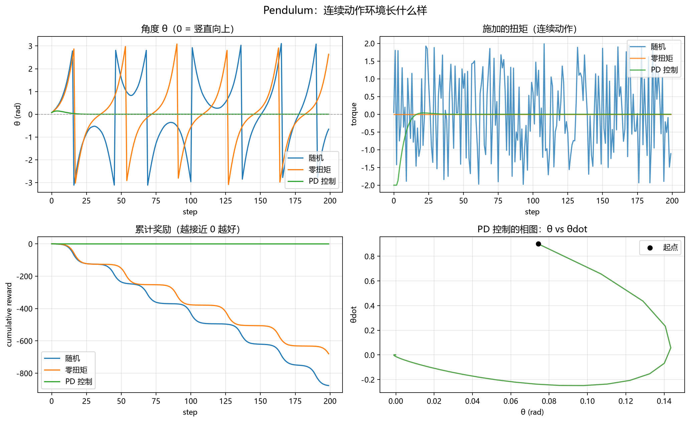

# 实验 25：Pendulum 入门——连续动作环境

脚本：`scripts/25_pendulum_intro.py`
图：`docs/images/25_pendulum_intro.png`

这个脚本不训练，只回答一个问题：**连续动作的环境到底长什么样？**

---

## 1. 环境接口

```text
observation_space: Box([-1, -1, -8], [1, 1, 8], (3,), float32)
action_space:      Box(-2.0, 2.0, (1,), float32)
max_episode_steps: 200
```

状态 3 维：

```text
obs[0] = cosθ
obs[1] = sinθ
obs[2] = θdot（角速度）
θ = atan2(obs[1], obs[0])
```

动作用 Box 而不是 Discrete：

```text
action = [torque]，torque 可以是 [-2, 2] 里的任意实数
```

这就是「连续动作」：不是从 2 个选项里挑，而是输出一个实数。

---

## 2. 奖励

```text
reward = -(θ² + 0.1 × θdot² + 0.001 × torque²)
```

- θ 越接近 0（竖直向上）越好；
- 角速度越小越好；
- 用力越小越好；
- 奖励是负的，越接近 0 越好。

---

## 3. 三种策略对比

脚本跑了 200 步：

| 策略 | 总奖励 | 平均扭矩 |
| --- | --- | --- |
| 随机动作 | -876.5 | 0.97 |
| 零扭矩 | -680.0 | 0.00 |
| 简单 PD | **-0.4** | 0.08 |

PD 控制器：

```text
torque = -kp × θ - kd × θdot
kp = 10, kd = 2
再裁剪到 [-2, 2]
```

直觉：角度偏了就反向推；角速度大就加阻尼。



四个面板：

1. **角度**：随机和零扭矩会来回翻转；PD 把 θ 稳定在 0.14 rad 以内；
2. **扭矩**：连续动作是一条平滑曲线，不是离散的 0/1；
3. **累计奖励**：PD 几乎水平（每步只损失一点点），随机/零扭矩一路下滑；
4. **相图**：PD 从初始角度出发，螺旋收敛到 θ≈0 附近。

---

## 4. 这说明什么

- 连续动作环境并不神秘，只是动作是一个实数；
- 一个手调 PD 就能接近最优（return -0.4），说明这个任务本身不难；
- 但 PD 需要人知道「角度、角速度、该往哪推」；
- 强化学习要做的是：**不看公式，只从 reward 里学出类似的控制策略**。

---

## 5. 和 PPO 的关系

CartPole 的 PPO：

```text
Actor 输出 2 个 logit → softmax → 离散动作
```

Pendulum 的 PPO：

```text
Actor 输出 μ(s) 和 logσ(s)
a ~ Normal(μ, σ²)
再裁剪到 [-2, 2]
log π(a|s) 用高斯密度公式
```

PPO 的 ratio 裁剪、GAE、value loss 都不变，只把 `Categorical` 换成 `Normal`。

---

## 6. 下一步

实现连续动作 PPO：

1. Actor 输出 `mu` 和 `log_std`；
2. 采样动作并计算高斯 log_prob；
3. 在 Pendulum 上训练；
4. 画角度曲线，和 PD 的 -0.4 对比。

---

## 7. 复现

```bash
uv run python scripts/25_pendulum_intro.py
```

产物：`outputs/25_pendulum_intro/pendulum_intro.png`。
