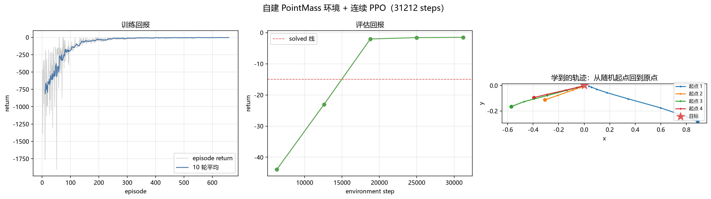

# 实验 27：自建 PointMass 环境 + 连续 PPO

脚本：`scripts/27_ppo_pointmass.py`
环境：`src/rldl/pointmass.py`
图：`docs/images/27_pointmass.png`

---

## 1. 自建环境是什么

就是自己写一个 `gym.Env` 子类，定义 MDP 的五个要素。

本次任务：

```text
一个二维平面上的点，目标是把点推回原点 (0,0)
```

### 状态（4 维）

```text
[x, y, vx, vy]
```

### 动作（2 维连续）

```text
[fx, fy]，范围 [-1, 1]
```

### 动力学

```text
v = 0.9 v + 0.1 a
p = p + v
```

有阻尼，推力每步最多让速度增加 0.1。

### 奖励

```text
reward = -||p|| - 0.01 × ||a||²
```

- 离原点越远，惩罚越大；
- 用力越大，轻微惩罚；
- 到达原点附近（距离 < 0.05）终止；
- 最多 100 步截断。

### 代码结构

```python
class PointMassEnv(gym.Env):
    observation_space = Box(-inf, inf, (4,), float32)
    action_space      = Box(-1, 1, (2,), float32)

    def reset(self, seed=None, options=None):
        ...
        return obs, {}

    def step(self, action):
        ...
        return next_obs, reward, terminated, truncated, info
```

这四个东西——两个 space、`reset`、`step`——就是「自建 gymnasium 环境」的全部要求。

---

## 2. 用连续 PPO 训练

完全复用实验 26 的连续 PPO：

- 高斯策略：μ(s) + 可学习 logσ；
- 动作裁剪到 [-1, 1]；
- GAE：成功终止时 `last_value=0`，截断时用 `V(s_T)` 自举；
- PPO 裁剪、多轮 minibatch。

| 项 | 值 |
| --- | --- |
| 总步数上限 | 100000 |
| rollout | 2048 |
| update epochs | 10 |
| lr | 3e-4 |
| γ / λ | 0.99 / 0.95 |
| clip | 0.2 |
| 评估 | 每 5000 步，5 局 |

---

## 3. 结果

```text
step   6272 | train_return=-292.7 | eval= -43.9 | std=1.024
step  12585 | train_return=-116.9 | eval= -23.1 | std=0.958
step  18788 | train_return= -37.9 | eval=  -2.0 | std=0.881
step  24995 | train_return=  -8.1 | eval=  -1.6 | std=0.807
step  31212 | train_return=  -3.5 | eval=  -1.5 | std=0.721
连续 3 次评估达到 -15，提前停止
best eval return = -1.5
CPU 总耗时约 63 秒
```



- 训练回报从 -1800 上升到接近 0；
- 评估在 -1.5 附近，几乎每一步都在向原点靠近；
- σ 从 1.02 降到 0.72，探索逐渐减小；
- 右图是从四个随机起点学到的轨迹，都收敛到原点附近。

---

## 4. 这个实验的意义

自建环境让你能完全控制任务：

- 改状态维度、动作范围、奖励函数；
- 设计稀疏奖励、延迟奖励、障碍物；
- 观察算法在哪些设计下会失败。

本任务很简单：奖励密集、动力学线性、状态完全可观测，所以 PPO 31k 步就学会了。

如果改成：

- 只有到达才给 +1（稀疏奖励）；
- 动作有噪声；
- 状态只能看到部分信息；

难度会立刻上升，那时才需要更复杂的技巧（reward shaping、RNN、curriculum）。

---

## 5. 常见坑

1. **`reset` 没返回 `(obs, info)`**：新版 gymnasium API 要求二元组；
2. **`step` 没返回五元组**：`(obs, reward, terminated, truncated, info)`；
3. **终止和截断混在一起**：终止要 `last_value=0`，截断要 bootstrap；
4. **奖励尺度没设计好**：太大/太小都会影响 value loss；
5. **动作没裁剪**：环境可能收到越界动作，行为不可预测。

---

## 6. 自己动手

```bash
# 默认
uv run python scripts/27_ppo_pointmass.py

# 把动作范围改成 [-0.2, 0.2]，看是否学得更慢
# （修改 pointmass.py 的 action_space 和 step 里的 clip）

# 加一个障碍物：距离某点 < 0.2 时 reward -= 1

# 把奖励改成稀疏：只有 terminated 时 +1，其余 0
```

观察点：

1. 稀疏奖励下 PPO 还能学会吗？
2. 动作范围变小，收敛步数怎么变？
3. 加障碍物后，策略会不会绕路？

---

## 7. 下一步

阶段 5 还剩：

1. **多 seed 实验报告**：PPO / A2C / DQN 各 3–5 个种子，均值±标准差；
2. **离散化对比**：把连续动作离散成 5×5，用 DQN，比较精度和样本效率；
3. **视觉输入**：用 CNN 处理像素状态。
