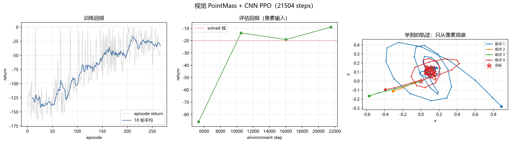

# 实验 28：视觉输入——从像素学习 PointMass 控制

脚本：`scripts/28_ppo_visual_pointmass.py`
环境：`src/rldl/pointmass_visual.py`
网络：`src/rldl/visual_policy.py`
图：`docs/images/28_visual_pointmass.png`

---

## 1. 视觉环境

状态不再是 4 个数字，而是 32×32 RGB 图像：

```text
蓝点：当前位置
绿圈：目标（原点）
红线：速度方向和大小
```

`observation_space`：

```text
Box(0, 1, (3, 32, 32), float32)
```

图像由 `PointMassPixelEnv` 实时渲染，底层仍然是实验 27 的 `PointMassEnv`，只是把 4 维状态画成图。

---

## 2. CNN 策略网络

```text
输入 (3, 32, 32)
Conv 3×3, 16, stride 2 → 16×16
Conv 3×3, 32, stride 2 → 8×8
Flatten → 2048
  ├── μ head → 2 维动作
  ├── logσ → 可学习参数
  └── V head → 1 个状态价值
```

和实验 26 的高斯 PPO 完全一样，只是把 MLP 换成 CNN。

---

## 3. 第一次失败

最初配置：

```text
48×48 图像
无边界
奖励不缩放
```

结果：

```text
eval ≈ -6000
```

原因：

- 随机策略会把点推飞，位置无边界，回报越来越大；
- value loss 巨大，PPO 学不动；
- 48×48 + 3 层卷积 + 10 轮更新，CPU 太慢。

修改：

1. 图像 48×48 → **32×32**；
2. 网络 3 层卷积 → **2 层**；
3. 环境加**边界 ±1.5**，撞墙速度清零；
4. 奖励缩放 **0.1**；
5. rollout 1024 → 512，update epochs 6 → 4。

---

## 4. 结果

```text
step   5325 | train_return(10)= -131.3 | eval= -86.0 | std=0.992
step  10518 | train_return(10)=  -68.2 | eval= -13.7 | std=0.969
step  16017 | train_return(10)=  -50.3 | eval= -19.1 | std=0.936
step  21504 | train_return(10)=  -33.7 | eval=  -9.0 | std=0.895
连续 3 次评估达到 -20，提前停止
best eval return = -9.0
CUDA 总耗时约 4 分钟
```



- 训练回报从 -150 升到 -30 左右；
- 评估达到 -9，说明 CNN 能从像素里判断「点在哪、目标在哪、往哪推」；
- σ 从 0.99 降到 0.90，探索略减。

右图轨迹：

- 大部分起点能回到目标；
- 有一个起点绕了很大一圈，说明视觉策略不如状态输入精确；
- 这是正常现象：像素少了速度的精确数值，只能从红线估计。

---

## 5. 和状态输入的对比

| | 实验 27（状态） | 实验 28（像素） |
| --- | --- | --- |
| 输入 | 4 个数字 | 3×32×32 图像 |
| 网络 | MLP | CNN |
| 达标步数 | 31k | 21.5k |
| 最好 eval | -1.5 | -9.0 |
| 样本效率 | 高 | 低（但能学） |

像素输入需要 CNN 自己提取位置/目标/速度，精度和样本效率都会下降。

---

## 6. 常见坑

1. **奖励不缩放**：value loss 太大，PPO 不学习；
2. **图像太大**：48×48 在 CPU 上很慢，32×32 足够；
3. **没有边界**：随机策略会把点推飞，回报无下界；
4. **CNN 太深**：小图像不需要很多层，2 层卷积足够；
5. **速度信息丢失**：单帧只有位置，速度靠红线；如果去掉红线，就需要帧堆叠。

---

## 7. 自己动手

```bash
# 默认
uv run python scripts/28_ppo_visual_pointmass.py

# 用 CPU（会慢很多）
uv run python scripts/28_ppo_visual_pointmass.py --device cpu

# 关掉奖励缩放，观察是否学不动
uv run python scripts/28_ppo_visual_pointmass.py --reward-scale 1.0

# 训练更久
uv run python scripts/28_ppo_visual_pointmass.py --total-steps 60000
```

观察点：

1. 去掉速度红线，策略还能学会吗？
2. 图像从 32 改到 48，训练时间变化多少？
3. `--reward-scale 1.0` 时 value loss 是否爆炸？

---

## 8. 阶段 5 进度

```text
连续动作 PPO（Pendulum）        ✓
自建 PointMass 环境 + PPO       ✓
视觉输入（CNN + PPO）           ✓
多 seed 实验报告                 ⏳
```

下一步：多 seed 实验报告，把 DQN / A2C / PPO 在多个种子下的结果做成均值±标准差对比。
